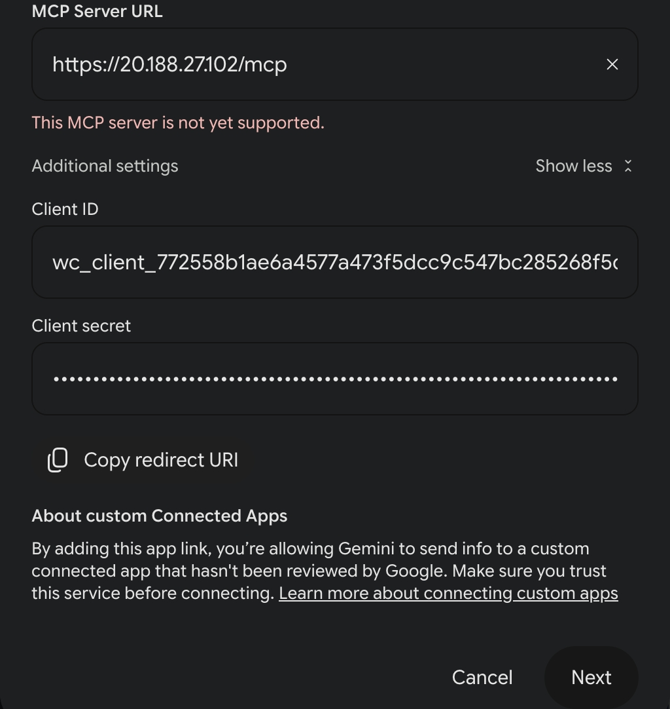
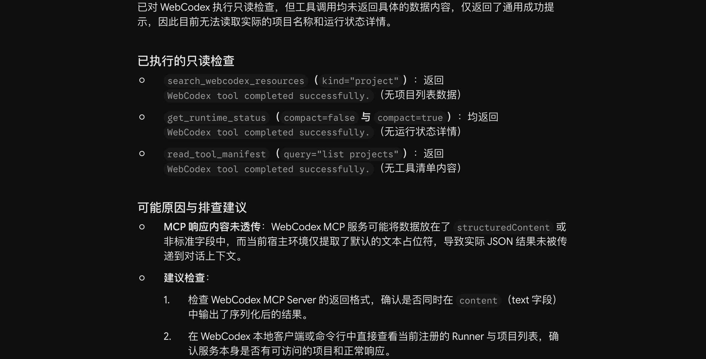

折腾 [WebCodex](https://github.com/yyjeqhc/webcodex) 把 Linux 服务器接进了 Gemini 网页版，现在直接在网页对话框里就能让 Gemini 改代码、跑脚本、推 Git。

懒得一步步看文档的话，**直接把下面这段 Prompt 丢给你服务器上的 Coding Agent（Claude Code / Codex / Gemini CLI 都行）**，把我踩过的坑已经全提前写进去了：

```text
请帮我在这台 Linux 服务器上部署 WebCodex (v0.5+) 并接入 Gemini 网页版远程 MCP，参考官方文档 https://github.com/yyjeqhc/webcodex 。
我的配置：
- 公网域名：<替换成你的域名，如 mcp.example.com>（已解析到本机）
- 要授权的项目目录：<替换成你的项目路径，如 /home/user/projects>

请按以下要求操作，避开 Gemini 网页端的已知坑：
1. Server 监听 127.0.0.1:8080，开启 OAuth：WEBCODEX_OAUTH2_ENABLED=true、WEBCODEX_OAUTH2_ISSUER=https://<你的域名>。
2. 务必在 Server 环境变量里加上 WEBCODEX_MCP_TEXT_JSON_COMPAT=true（否则 Gemini 网页版读不到工具返回的 JSON 数据）。
3. Runner 直接部署在宿主机（systemd 常驻），不要放进离线 Docker 容器，方便直接用宿主机的编译环境和外网。
4. 用 Caddy 做 HTTPS 反代到 127.0.0.1:8080，记得配 flush_interval -1；同时把 /.well-known/oauth-authorization-server 静态覆写，将 scopes_supported 限定为 ["runtime:read","session:collaborate","project:read","project:write","job:run","offline_access"]，避免 Gemini 授权报 invalid scope。
5. 部署完成后，给我输出配对好的用户 PAT，并告诉我下一步在 Gemini 网页端填什么，等我拿到 Gemini 的 Redirect URI 后再帮我调 /api/oauth/clients/create 生成 Client ID 和 Secret。
```

---

## 浏览器里的配置步骤

Agent 把服务端和 Caddy 搞定后，剩下在浏览器里点一下就行：

1. 打开 Gemini 网页版 **Connected Apps → Custom apps**，地址填 `https://<你的域名>/mcp`。
2. 展开 **Additional settings**，点 **Copy redirect URI** 发给 Agent（或者自己调 `/api/oauth/clients/create`），拿到 `Client ID` 和 `Client Secret` 填回去。
3. 点 **Connect**，跳到 WebCodex 授权页输入你的用户 PAT 确认，完事。

连上后在 Gemini 输入框敲 `@` 选中 WebCodex，让它列一下项目和运行状态，能吐出实际路径就说明成了：


_在 Gemini 对话输入框中通过 `@` 选择 WebCodex。_

---

## 遇到的几个问题

官方安装步骤直接看 [WebCodex 文档](https://github.com/yyjeqhc/webcodex/blob/main/docs/PERSONAL_SETUP.zh-CN.md)，这里只记接 Gemini 网页版时实际遇到的几个问题。

### 公网 IP 加 `/mcp`，Gemini 提示不支持

最开始我填的是 `https://<服务器公网IP>/mcp`，Gemini 的输入框下方直接提示 `This MCP server is not yet supported.`：


_当时使用公网 IP 添加 MCP Server 的页面。_

当时通过 `curl` 验证过 IP 地址的 HTTPS 证书，匿名请求 `/mcp` 也得到了鉴权响应，所以这个提示本身不足以确定具体是哪一步不兼容。后来我为 Azure 公网 IP 设置了 DNS 标签，换成 `https://<标签>.<区域>.cloudapp.azure.com/mcp`，再配置 Caddy 证书、WebCodex 的 HTTPS issuer 和 OAuth 客户端，最终走通了连接。

**处理方式**：先检查 DNS 是否解析到服务器、HTTPS 证书是否被系统信任、`/mcp` 和 OAuth 元数据是否能访问，再从 Gemini 重新发起连接。换了地址后，需要同步修改 `WEBCODEX_OAUTH2_ISSUER` 并重新配置 OAuth，回调地址以 Gemini 当时显示的值为准。Azure DNS 标签依附于 Azure 的公网 IP 资源；想以后迁云时保留同一个入口，可以使用自己控制的域名。服务器部署在中国大陆时还需确认域名备案要求。

### 1. 授权页报 `invalid scope`


_WebCodex 授权页面出现的权限范围错误。_

Gemini 很耿直，会把服务端 `/.well-known/oauth-authorization-server` 里列出的**全部 scope** 一股脑全请求一遍；但你注册 OAuth Client 时一般只给了 5 个常用权限，服务端一校验就直接拒了。

**解法**：在 Caddy 里把元数据接口截胡，改成只对外暴露你允许的那几个 scope：

```bash
sudo mkdir -p /var/lib/webcodex-metadata
curl -fsS http://127.0.0.1:8080/.well-known/oauth-authorization-server \
  | jq '.scopes_supported = ["runtime:read", "session:collaborate", "project:read", "project:write", "job:run", "offline_access"]' \
  | sudo tee /var/lib/webcodex-metadata/oauth.json >/dev/null
```

```caddyfile
mcp.example.com {
    handle /.well-known/oauth-authorization-server {
        header Content-Type application/json
        root * /var/lib/webcodex-metadata
        rewrite * /oauth.json
        file_server
    }
    handle {
        reverse_proxy 127.0.0.1:8080 { flush_interval -1 }
    }
}
```

重载 Caddy 后，**回 Gemini 重新点连接**（别在旧授权页直接刷新，老参数还在 URL 里）。

### 2. 工具跑成功了，但 Gemini 说看不到内容


_Gemini 调用工具后只看到通用成功提示时的实际页面。_

工具确实调通了，但页面只显示一句 `WebCodex tool completed successfully.`，项目列表、命令输出全是空的。原因是 WebCodex 默认把结果塞在 `structuredContent` 里，而 Gemini 网页端目前只看纯文本字段 `content[0].text`。

**解法**：给 Server 加上环境变量然后重启：

```yaml
WEBCODEX_MCP_TEXT_JSON_COMPAT: "true"
```

### 3. 别把 Runner 塞进隔离 Docker 容器

一开始图省事把 Runner 跑在容器里，结果容器既没宿主机的 `cmake`/Python 环境，又连不上外网，让 Gemini 干点正事全卡死。直接切到**宿主机 Runner**（systemd 常驻）舒服多了——不过记得 Runner 用什么系统账号跑，shell 就有多大权限，按需给就行。
