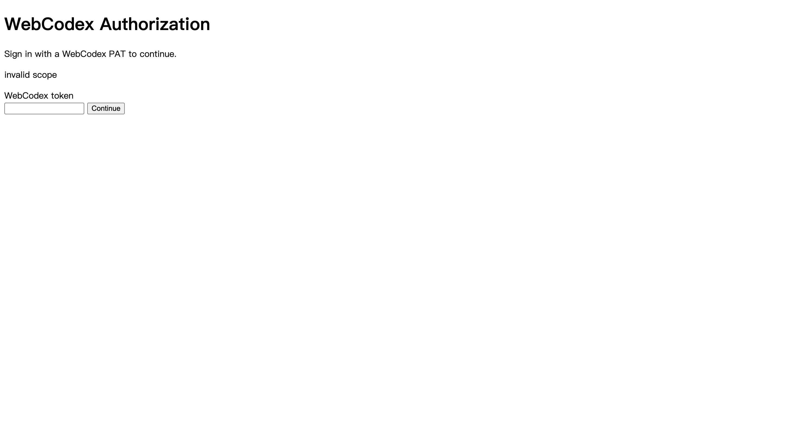
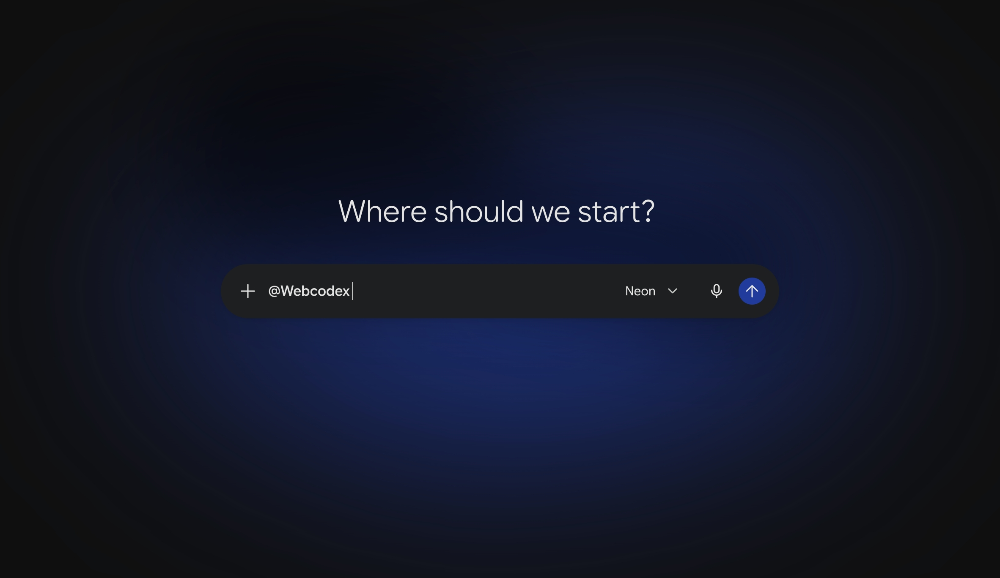

最近想直接在 Gemini 网页版里读改自己云服务器上的代码和毕设文档，不想每次手动复制粘贴。折腾了一圈，用 [WebCodex](https://github.com/yyjeqhc/webcodex)（v0.5）走远程 MCP + OAuth 跑通了。

官方文档本身写得挺全（[个人安装](https://github.com/yyjeqhc/webcodex/blob/main/docs/PERSONAL_SETUP.zh-CN.md) / [部署](https://github.com/yyjeqhc/webcodex/blob/main/docs/DEPLOYMENT.zh-CN.md) / [MCP](https://github.com/yyjeqhc/webcodex/blob/main/docs/MCP.zh-CN.md)），这里不重复搬运，只记**跑通的最短路径**和**接入 Gemini 网页版时踩到的三个真实坑**。

整体链路很简单：`Gemini 网页版 -> Caddy (HTTPS) -> WebCodex Server (127.0.0.1:8080) -> Runner (本机项目与终端)`。

## 关键步骤

### 1. 起 Server 并配对 Runner

装好 `webcodex` 后，先在服务器上把 Server 跑起来：

```bash
webcodex server init \
  --listen 127.0.0.1:8080 \
  --data-dir "$HOME/.local/share/webcodex" \
  --env-file "$HOME/.config/webcodex/webcodex.env"

webcodex server run --env-file "$HOME/.config/webcodex/webcodex.env"
```

另开一个终端生成配对码，登录注册项目目录，顺手把 Runner 挂成常驻服务：

```bash
webcodex pairing create \
  --server-url http://127.0.0.1:8080 \
  --env-file "$HOME/.config/webcodex/webcodex.env" \
  --username <用户名> --ttl-secs 600

webcodex login http://127.0.0.1:8080 \
  --code <配对码> \
  --allowed-root /path/to/projects \
  --project /path/to/projects/my-project

webcodex runner install --scope user --config <登录输出的runner配置路径>
```

> 后面想追加别的项目目录，直接 `webcodex project register --config <runner配置路径> /path/to/another-repo` 就行。

### 2. 开 OAuth + Caddy 反代

Gemini 远程 MCP 必须走受信任的公网 HTTPS。在 Server 环境变量里把 OAuth 打开：

```bash
WEBCODEX_OAUTH2_ENABLED=true
WEBCODEX_OAUTH2_ISSUER=https://mcp.example.com
```

重启 Server 后，用 Caddy 反代到 `127.0.0.1:8080`（记得关缓冲，不然流式 MCP 会卡住）：

```caddyfile
mcp.example.com {
    reverse_proxy 127.0.0.1:8080 {
        flush_interval -1
    }
}
```

测一下外部连通性，第一条返回 `401`、第二条能出 OAuth 元数据 JSON 就算通了：

```bash
curl -i https://mcp.example.com/mcp
curl -fsS https://mcp.example.com/.well-known/oauth-authorization-server
```

### 3. 在 Gemini 里建 Custom App 并注册 Client

1. 打开 Gemini 的 **Connected Apps → Custom apps**，填 `https://mcp.example.com/mcp`。
2. 展开 **Additional settings**，点 **Copy redirect URI** 复制回调地址。
3. 回服务器用自己的用户 PAT 调接口创建 OAuth Client，拿到 `client_id` 和 `client_secret`：

```bash
umask 077
read -rsp 'WebCodex 用户 PAT: ' WEBCODEX_PAT; echo
read -r -p 'Gemini Redirect URI: ' GEMINI_REDIRECT

jq -n --arg uri "$GEMINI_REDIRECT" \
  '{name:"Gemini", redirect_uris:[$uri], allowed_scopes:["runtime:read","session:collaborate","project:read","project:write","job:run"]}' \
  | curl -fsS http://127.0.0.1:8080/api/oauth/clients/create \
      -H "Authorization: Bearer $WEBCODEX_PAT" \
      -H 'Content-Type: application/json' \
      --data-binary @- > "$HOME/gemini-webcodex-oauth.json"
chmod 600 "$HOME/gemini-webcodex-oauth.json"
```

把生成的 Client ID / Secret 填回 Gemini，点 Connect 跳到 WebCodex 授权页输入 PAT 确认就行。

---

## 踩坑与报错处理

### 坑 1：授权页直接报 `invalid scope`


_WebCodex 授权页面出现的权限范围错误。_

**原因**：Gemini 发起授权时，会把 `/.well-known/oauth-authorization-server` 里公布的**所有 scope** 全带上；而我注册的 OAuth Client 只允许上面那 5 个 scope，服务端一校验就直接拒了。

**解决**：别为了省事给客户端全开权限，直接在 Caddy 层把 `/.well-known/oauth-authorization-server` 拦下来，只对外暴露这 5 个 scope + `offline_access`：

```bash
sudo mkdir -p /var/lib/webcodex-metadata
curl -fsS http://127.0.0.1:8080/.well-known/oauth-authorization-server \
  | jq '.scopes_supported = ["runtime:read", "session:collaborate", "project:read", "project:write", "job:run", "offline_access"]' \
  | sudo tee /var/lib/webcodex-metadata/oauth.json >/dev/null
```

改一下 Caddyfile 并重载（Caddy 跑在容器里的话记得把这个目录挂进去）：

```caddyfile
mcp.example.com {
    handle /.well-known/oauth-authorization-server {
        header Content-Type application/json
        root * /var/lib/webcodex-metadata
        rewrite * /oauth.json
        file_server
    }
    handle {
        reverse_proxy 127.0.0.1:8080 {
            flush_interval -1
        }
    }
}
```

**注意**：改完后必须回 Gemini **重新发起连接**，在旧授权页直接刷新提交还是带着老参数，照样报错。

### 坑 2：工具调用显示成功，但 Gemini 根本看不到数据


_Gemini 调用工具后只看到通用成功提示时的实际页面。_

**现象**：连上之后让 Gemini 列项目，工具确实执行了，结果只吐出一句 `WebCodex tool completed successfully.`，项目列表、运行状态全是空的。

**原因**：WebCodex 默认把结构化结果放在 MCP 的 `structuredContent` 里，而 Gemini 网页端当前只把 `content[0].text` 喂给模型。

**解决**：在 Server 环境变量里打开文本 JSON 兼容开关，然后重启/重建 Server：

```yaml
environment:
  WEBCODEX_MCP_TEXT_JSON_COMPAT: "true"
```

打开之后，工具返回会同时把完整 JSON 塞进文本字段，Gemini 就能正常读到项目列表和命令输出了（代价是会多占一点上下文 token，不过能用比啥都强）。

### 坑 3：容器 Runner 没外网、缺工具链

一开始图省事把 Runner 塞在 Docker 容器里，结果发现就算把项目目录挂进去了，容器里既没有宿主机的 `cmake`、Python 虚拟环境，又因为网络隔离连 GitHub 和 HuggingFace 都拉不动，干活极其憋屈。

最后直接切成了**宿主机 Runner**，用 systemd 常驻，直接复用宿主机整套编译环境和网络。不过要心里有数：**Runner 跑在什么系统账号下，shell 命令就有多大权限**，平时用普通低权限账号就够了，真需要动系统环境再视情况提权。

---

## 验收


_在 Gemini 对话输入框中通过 `@` 选择 WebCodex。_

在 Gemini 输入框敲 `@` 选中 WebCodex，先来一句只读测试：

```text
请列出当前可访问的项目和运行状态，只做只读检查。
```

能准确吐出项目列表、路径和 Runner 在线状态就说明全链路通了。平时如果断连或者工具报错，直接看这两处日志基本就能定位：

```bash
# Server 日志（Docker Compose）
docker compose logs --tail=100 webcodex

# Runner 状态与日志
webcodex runner status --scope user --config <runner配置路径>
webcodex runner logs --scope user --config <runner配置路径> --lines 100
```
