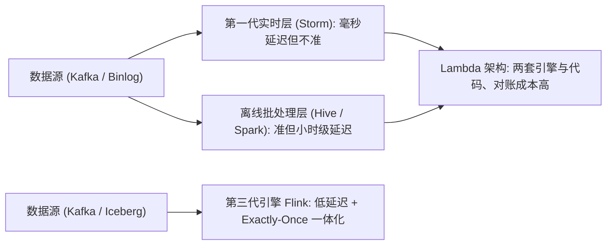
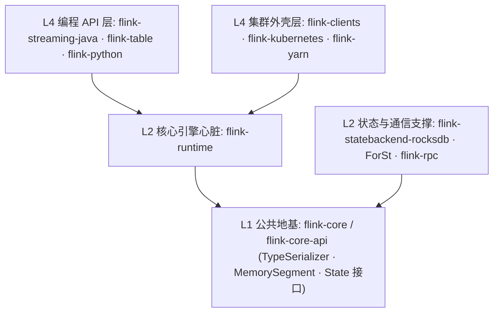
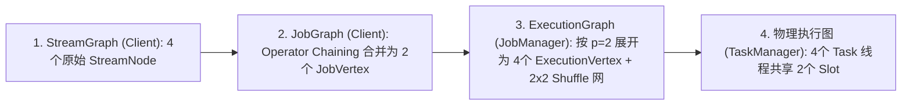
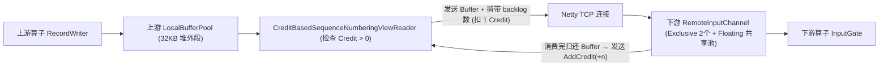
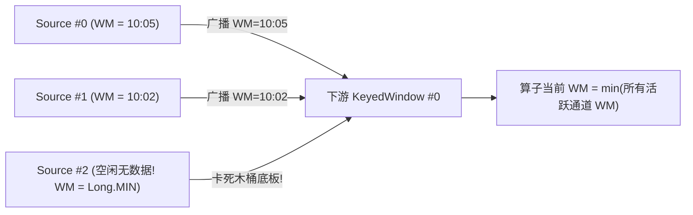
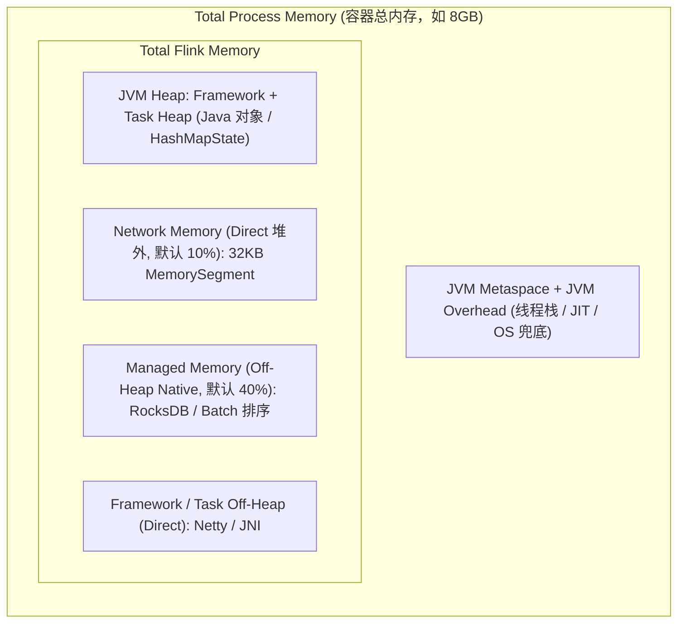
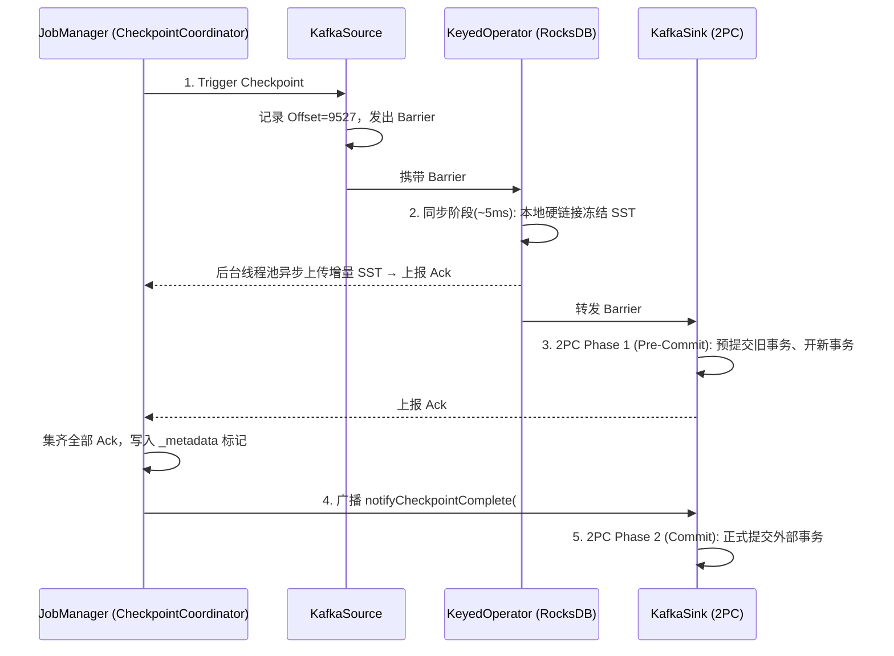

> 本文是一份面向 **Data Infra 研发视角** 重写的现代 Apache Flink 讲义（基于 **Apache Flink 2.3.0** 源码核验）。相比传统偏重 Flink 1.13 API 的教程，本文剔除了已废弃的旧接口，重点补齐了仓库模块地图、Mailbox 单线程模型、Credit 网络反压与 Debloating、FLIP-49 统一内存模型、Flink 2.x 存算分离（ForSt + AEC）、Checkpoint 与 2PC 容错机制，以及基于 Flink 构建分布式 Agent 运行时（Apache Flink Agents）的实战映射。
{: .prompt-info }

## 第 1 章 初识 Flink 与流批一体演进

### 1.1 Flink 的定位：有状态流计算引擎

Apache Flink 的官方定位只有一句话：**Stateful Computations over Data Streams（数据流上的有状态计算）**。

理解 Flink 必须先建立一个核心认知：
- **传统批处理引擎（Hadoop / Spark）的视角**：世界是**批（Batch）**的——先把数据落进静态表定时跑批；需要实时计算时，把数据流切成一个个短时间片（Micro-Batch 微批）。
- **Flink 的视角**：世界本质上是**无界流（Unbounded Stream）**——订单、点击、日志源源不断地产生；所谓“批数据（Bounded Stream）”，不过是有起点和终点的**特殊流**。

### 1.2 从 Lambda 架构到流批一体



- **第一代流处理（Storm）**：低延迟、无内置状态容错，只能保证 At-Least-Once，吞吐低且结果难以保证精确。
- **第二代（Lambda 架构）**：实时层给近似值，离线层半夜跑批修正。致命伤是要维护**两套引擎、两套代码、两套数据口径**，开发和对账成本翻倍。
- **第三代（Flink）**：依靠 **事件时间（Event Time）+ Watermark** 解决乱序问题，依靠 **轻量级分布式快照（Checkpoint）+ 状态后端** 实现**高吞吐 + 毫秒级延迟 + 端到端 Exactly-Once**，一套系统终结 Lambda。

### 1.3 Flink vs Spark 核心对比

| 对比维度 | Apache Flink | Apache Spark（Streaming / Structured Streaming） |
| :--- | :--- | :--- |
| **核心抽象** | **流为核心**（批是有界流） | **批为核心**（微批 Micro-Batch 模拟流） |
| **延迟水平** | **真逐条流式处理，毫秒级** | 微批切分，通常百毫秒到秒级 |
| **时间与乱序** | 原生深度支持 Event Time、Watermark、AllowedLateness | 支持较弱，复杂乱序与自定义状态不如 Flink 灵活 |
| **容错机制** | 异步分布式快照 **Chandy-Lamport（Checkpoint）** | RDD 血缘（Lineage）重算 + WAL |
| **内存与反压** | 自研堆外内存（Managed Memory）+ **Credit-based 流控** | Unified Memory Manager + 动态限速（RateController） |
| **擅长场景** | 实时数仓、实时风控、实时特征、CDC 同步、流式 Agent | 超大规模离线 ETL、复杂交互式批分析、传统 ML 批处理 |

---

## 第 2 章 Flink 2.x 代码仓库地图与云原生部署

阅读大型开源项目源码的第一铁律：**先认清模块分层和依赖方向，再钻进具体类**。

### 2.1 顶层 Maven 模块 5 层地图（基于 Flink 2.3.0）



> **Flink 1.x → 2.x 重大目录变化**：许多早期教程会引导读者去 `flink-streaming-java` 找 `StreamTask`、`MailboxProcessor`、`SingleCheckpointBarrierHandler`。在 **Flink 2.0+** 中，流式执行引擎已合并进 **`flink-runtime`**（包路径仍为 `org/apache/flink/streaming/runtime/`），直接在 `flink-runtime` 下定位即可。
{: .prompt-warning }

### 2.2 `flink-runtime` 内部包切分：控制面 vs 数据面

打开 `flink-runtime`，可以按 **JobManager（控制面）** 和 **TaskManager（数据面）** 清晰切分为两部分：

```text
org/apache/flink/
├── runtime/
│   ├── dispatcher/ & jobmaster/       # [JM 控制面] 接收作业、管理单个 Job 生命周期
│   ├── executiongraph/ & scheduler/   # [JM 控制面] 并行图展开、调度与局部 Failover
│   ├── resourcemanager/ & slots/      # [JM 控制面] 集群资源管理、TM 注册与 Slot 分配
│   ├── checkpoint/                    # [JM 控制面] CheckpointCoordinator 全局协调
│   ├── taskexecutor/ & taskmanager/   # [TM 数据面] TaskManager 进程与 Task 线程封装
│   ├── io/network/ & memory/          # [TM 数据面] LocalBufferPool、Credit 反压、MemoryManager
│   └── state/ & asyncprocessing/      # [TM 数据面] 状态管理与 Flink 2.x AEC 异步执行控制器
└── streaming/runtime/                 # [TM 数据面核心]
    ├── tasks/ & tasks/mailbox/        # StreamTask、MailboxProcessor、TaskMailboxImpl
    └── io/checkpointing/              # SingleCheckpointBarrierHandler (对齐/非对齐)
```

### 2.3 云原生部署模式（Flink 2.x 现状）

Flink 1.x 中的 **Per-Job 模式在 Flink 2.x 已彻底移除**，现代生产主要采用两种模式：

1. **Session Mode（会话模式）**：先启动常驻的 JobManager 与一组 TaskManager，多个作业共享集群资源。适合开发测试或短平快即席查询，但资源隔离弱。
2. **Application Mode（应用模式，生产绝对主力）**：每个作业独占一套 JobManager + TaskManager，**用户的 `main()` 直接在 JobManager 容器内执行**。目前主流生产形态为 **Application Mode on Kubernetes + Apache Flink Kubernetes Operator**（借助 K8s CRD + Reconcile 循环实现自动扩缩容 Autoscaler、Savepoint 滚动升级与故障自愈）。

> **本地源码调试技巧**：在 IDE 里直接运行任意 Flink 单元测试，底层会在单 JVM 内自动拉起 **`MiniCluster`**（同时运行 JM 与 TM）。在 `StreamTask.invoke()` 或 `MailboxProcessor.runMailboxLoop()` 打断点单步跟踪，即可看穿完整执行链路。
{: .prompt-tip }

---

## 第 3 章 运行时架构、四层图转换与算子链

### 3.1 集群核心角色分工

- **Client（客户端）**：编译用户代码生成 `StreamGraph` → 优化合并成 `JobGraph`，提交给集群。
- **JobManager（控制面大脑）**：
  - **Dispatcher**：接收作业提交（REST 接口），为每个作业启动一个独立的 `JobMaster`。
  - **JobMaster**：掌管单个作业的“大管家”——将 `JobGraph` 展开成 `ExecutionGraph`，向 ResourceManager 申请 Slot，下发 Task，协调 Checkpoint 和故障恢复。
  - **ResourceManager**：掌管集群 Slot 资源（K8s 模式下动态向 API Server 申请/销毁 TaskManager Pod）。
- **TaskManager（数据面执行节点）**：真正处理数据的 JVM 进程，内部划分为若干 **Task Slot**，持有网络缓冲池（`NetworkBufferPool`）与托管内存（`MemoryManager`）。

### 3.2 四层图转换全链路

以经典实时链路 `KafkaSource(p=2) → filter(p=2) → keyBy(userId) → sum(p=2) → StarRocksSink(p=2)` 为例：



1. **StreamGraph（Client）**：`StreamGraphGenerator.generate()` 将 `Transformation` 列表一比一转为 `StreamNode` 和 `StreamEdge`，此时尚未合并算子，并行度只是节点属性。
2. **JobGraph（Client）**：`StreamingJobGraphGenerator` 执行最核心的编译优化——**Operator Chaining（算子链合并）**。
   - **合并收益**：若相邻算子分在两个线程运行，每条数据都要经历序列化、写入网络缓冲、跨线程上下文切换与反序列化；合并进同一个 `JobVertex` 后，链内算子在**同一个线程内直接做 Java 方法调用（传递对象引用）**，零网络、零序列化开销。
   - **算子链合并的 6 个充要条件**（源码 `StreamingJobGraphGenerator.isChainable()`）：
     1. 上下游算子并行度相同；
     2. 上下游处于同一个 `SlotSharingGroup`；
     3. 下游节点入度为 1（无多流合流）；
     4. 上下游之间分区策略必须为 `ForwardPartitioner`（遇到 `keyBy` / `rebalance` 立刻断开）；
     5. 上下游算子的 `ChainingStrategy` 允许合并；
     6. 未禁用全局或局部 Chaining。
3. **ExecutionGraph（JobManager）**：`DefaultExecutionGraph` 按并行度把每个 `JobVertex` 展开为 `ExecutionVertex` 数组；每个 `ExecutionVertex` 每次尝试运行生成一个带唯一 `ExecutionAttemptID` 的 `Execution`（用于容错重试隔离旧实例），并建立上游 `IntermediateResultPartition` 与下游的逻辑连接。
4. **物理执行图（TaskManager）**：JobMaster 申请到 Slot 后下发 `TaskDeploymentDescriptor`，TaskManager 拉起 `Task` 线程（执行 `StreamTask.restore()` → `StreamTask.invoke()`），落地为物理 `ResultPartition` ↔ `InputGate` 通道。

### 3.3 Slot 与 Slot 共享（SlotSharingGroup）

- **Slot 隔离边界**：Slot 隔离的是 **Managed Memory（托管内存）**，**不隔离 CPU**（同一 TM 内多个 Slot 共享 JVM 堆和 OS 线程调度）。
- **Slot 共享机制**：默认开启下，不同 `JobVertex` 的 Subtask（如 `Source→Filter #0` 与 `Sum→Sink #0`）可以共享同一个 Slot。好处是：① 整个作业所需总 Slot 数等于**最大并行度**而非各算子并行度之和；② IO 密集算子与计算/状态密集算子错峰利用资源，且同机通信走 `LocalInputChannel` 内存直传。

---

## 第 4 章 Task 执行心脏：Mailbox 单线程模型与 Credit 网络反压

### 4.1 Mailbox 单线程事件循环：彻底消灭 `checkpointLock`

#### 演进动机
在一个 `StreamTask` 中，数据流处理 `processElement`、定时器 `Timer` 触发、`Checkpoint` 同步快照以及异步 IO 回调都会访问算子状态。早期 Flink 用全局粗粒度锁 `checkpointLock` 保护状态，多线程锁争抢严重且在阻塞等待下游缓冲时极易死锁。

#### 核心设计（`MailboxProcessor` & `TaskMailboxImpl`）
现代 Flink 采用类似 Actor / Netty EventLoop 的 **Mailbox 单线程模型**：
- 外部线程（Timer、Checkpoint RPC、Async 回调）**禁止直接修改算子状态**，只能把任务包装成 `Mail` 投递进 `TaskMailbox`；
- 只有 **Task 主线程** 在 `MailboxProcessor.runMailboxLoop()` 中串行消费：

```java
// MailboxProcessor.java (核心骨架)
public void runMailboxLoop() throws Exception {
    while (isNextLoopPossible()) {
        // ① 优先清空信箱中所有待办 Mail（Checkpoint / Timer / Async 回调绝不饿死）
        while (processMail(localMailbox, false)) {}
        // ② 信箱空了，才执行默认动作：从 InputGate 读取一条上游数据驱动算子链
        if (isNextLoopPossible()) {
            mailboxDefaultAction.runDefaultAction(defaultActionContext);
        }
    }
}
```

#### 两个关键并发细节
1. **双缓冲 `queue + batch` 消除取信锁开销**（`TaskMailboxImpl.java`）：
   - 外部线程加 `ReentrantLock` 往 `queue` 放信，并置 `hasNewMail = true`；
   - 主线程优先从自己私有的 `ArrayDeque<Mail> batch` 里**完全无锁 O(1)** 取信（`tryTakeFromBatch()`）；
   - 仅当 `batch` 为空且 `hasNewMail == true` 时，才调用一次 `createBatch()` 加锁把 `queue` 中的信**整批搬进 `batch`**，将锁竞争平摊到趋近于 0。
2. **算子链内的 Priority（优先级）防死锁**：
   - `getMailboxExecutor(int priority)` 为算子链不同位置分配优先级——**越靠下游优先级越高**。
   - 上游调用 `yield()` 暂停等待下游腾出空间时，主线程只允许执行**更高优先级的下游 Mail**，避免单线程内循环死锁。

### 4.2 Credit-Based 网络栈与反压传导机制

#### 为什么不能靠 TCP 滑动窗口做反压？
同一台 TaskManager 上的几十个 Subtask **复用同一条 TCP 长连接**发往目标节点。若依赖 TCP 窗口反压，只要 1 个慢 Subtask 堵死连接，同连接上所有正常 Subtask 都会被连坐卡死。因此 Flink 在应用层按逻辑通道（`InputChannel`）独立实现了 **Credit-Based Flow Control**。



1. **两级缓冲（Exclusive + Floating）**：每个 `RemoteInputChannel` 保底独占 2 个 **Exclusive Buffer** 防饥饿；上游发包捎带 `backlog > 0` 时，下游按需向公用池借 **Floating Buffer** 提供弹性缓冲。
2. **反压传导链条**：下游变慢 → Exclusive 与 Floating 全部耗尽 → 停止向上游发 `AddCredit` → 上游 ViewReader 看到 `numCreditsAvailable == 0` 停止向 Netty 发数据包（Checkpoint Barrier 等事件包不扣 Credit）→ 上游 `LocalBufferPool` 写满并在 `requestMemorySegmentBlocking()` 阻塞 → 反压逐级传导至 Source 降速，**绝不撑爆内存**。
3. **两大进阶优化**：
   - **Buffer Debloating（`StreamTask.debloat()`）**：根据下游消费速率动态缩小每个 Buffer 的逻辑填充大小（如从 32KB 缩至 1KB），将反压管道内积压的在途数据压减 90%+，大幅缩短端到端延迟与 Checkpoint 对齐时间。
   - **Overdraft Buffer（`LocalBufferPool.setMaxOverdraftBuffersPerGate`）**：允许一条输入拆出多条输出（如 `flatMap`）时临时透支缓冲，防止单条记录处理中途阻塞导致无法响应 Checkpoint。

> **线上反压排障黄金口诀**：在 WebUI 看到一连串算子标红反压（`backPressuredTimeMsPerSecond` 高），**它们全都是受害者**！沿着数据流往下找，**第一个反压低但 `busyTimeMsPerSecond` 接近 1000ms（100%）的算子，才是真正的瓶颈真凶**。定位真凶后立刻查：① 数据倾斜；② 外部同步 IO 阻塞；③ RocksDB 磁盘 IO 或 Full GC（配合 `async-profiler` 火焰图定位）。
{: .prompt-tip }

---

## 第 5 章 DataStream 核心与 Flink 2.x 新 Source / Sink V2

### 5.1 物理分区策略对比

除最常用的 `keyBy`（按 Key 的 Hash 映射 KeyGroup）外，五种核心物理分区策略如下：

| 分区策略 | 路由规则 | 典型场景 |
| :--- | :--- | :--- |
| **`forward()`** | 上下游 1 对 1 直传（要求并行度相同） | 算子链合并前提，零网络开销 |
| **`rebalance()`** | **全局轮询（Round-Robin）**，上游每节点向所有下游节点均匀发 | 消除数据源倾斜（如 Kafka 某分区数据暴增） |
| **`rescale()`** | **局部组内轮询**（上下游成倍数关系时只连部分下游节点） | 比 `rebalance` 省大量网络连接数，轻量消倾斜 |
| **`shuffle()`** | 纯随机分配 | 极少使用，均匀性不如 `rebalance` |
| **`broadcast()`** | 每条数据广播复制给下游所有 Subtask | 下发小体量动态配置/风控规则（配合 BroadcastState） |

### 5.2 Flink 2.x 新架构：FLIP-27 Source 与 Sink V2

Flink 1.x 的 `SourceFunction` 和 `SinkFunction` 在 **Flink 2.x 已彻底移除**，全面升级为：

1. **FLIP-27 新 Source（流批一体基石）**：把“发现分片”与“读取分片”彻底解耦：
   - **`SplitEnumerator`（运行在 JobManager）**：发现新分片（Kafka 新分区、新文件、Flink CDC 切出的主键 Chunk）并动态分配给下游，支持故障重分配。
   - **`SourceReader`（运行在 TaskManager）**：并发拉取分片数据，并将进度（Offset）持久化到 Operator State。
2. **Sink V2**：将写入与提交解耦为 **`SinkWriter`**（写数据并预提交产出 `Committable`）+ **`Committer`**（Checkpoint 成功后统一提交事务），大幅简化 Kafka / Iceberg / Paimon / StarRocks 等端到端精确一次 Sink 的实现。

---

## 第 6 章 时间语义、Watermark 水位线与 Window 窗口内核

### 6.1 时间语义与 Watermark 本质

- **Event Time（事件时间，生产默认）**：数据自带的业务产生时间戳。即使网络延迟或宕机追数，重跑结果**完全确定且一致**。
- **Watermark（水位线）**：夹在数据流中携带时间戳 `t` 的控制消息，向系统宣告“事件时间 `<= t` 的数据已到齐，结束时间 `<= t` 的窗口可以触发”。有界乱序生成公式：
  `Watermark = maxTimestamp - outOfOrderness - 1ms`。

### 6.2 多并行度 Watermark 传递与“空闲分区卡死”



- **木桶效应**：上游广播 Watermark，下游算子维护所有输入通道的最新值，**取最小值**作为自身当前 Watermark。
- **高频故障与源码解法**：若某个 Kafka 分区长期无数据，该通道 Watermark 停留在 `Long.MIN_VALUE`，导致全局窗口卡死不输出。必须配置 `WatermarkStrategy.withIdleness(Duration.ofMinutes(1))`，底层由 **`StatusWatermarkValve`** 将超时无数据的通道标记为 `IDLE` 并在求最小值时自动忽略，来新数据时瞬间恢复 `ACTIVE`。

### 6.3 Window 内核、迟到数据三道防线与定时器源码

1. **窗口对齐**：时间窗口按自然整点左闭右开 `[start, end)` 对齐（`TimeWindow.getWindowStartWithOffset`），与第一条数据到达时间无关。
2. **增量 + 全量黄金组合**：大窗口严禁只用全量 `ProcessWindowFunction`（把所有明细塞进 `ListState` 极易 OOM），应使用 `.aggregate(AggregateFunction, ProcessWindowFunction)`——来一条增量累加进 O(1) 累加器，触发时再拼装窗口元数据输出。
3. **迟到数据三道防线**：
   - **第一道**：Watermark 设 `forBoundedOutOfOrderness` 吸收常规乱序；
   - **第二道**：窗口设 `.allowedLateness(...)` 延迟销毁状态，允许迟到数据再次触发修正输出；
   - **第三道**：`.sideOutputLateData(lateTag)` 将彻底关闭后到达的数据导入侧输出流，落离线表或告警队列做补数。
4. **底层源码（`WindowOperator` + `InternalTimerServiceImpl`）**：`WindowOperator` 把数据写入 `windowState` 并注册 `window.maxTimestamp()` 定时器；**`InternalTimerServiceImpl`** 底层使用**去重小顶堆（`KeyGroupedPriorityQueue`）**存放海量 Timer，Watermark 推进时循环弹出所有到期 Timer 回调 `onEventTime()`。Timer 属于 KeyedState 的一部分，随 Checkpoint 持久化，RocksDB 模式下可配置放堆内或落 RocksDB。

---

## 第 7 章 底层处理函数与多流 Join 原理

### 7.1 `KeyedProcessFunction`：构建复杂有状态逻辑的瑞士军刀

当标准算子无法满足自定义超时、状态机或精细定时需求时，使用 `KeyedProcessFunction`，它同时提供逐条数据访问、完整 `KeyedState` 读写、Event/Processing `TimerService` 与 `Side Output` 侧输出流。

> **实时滑动 TopN 防泄漏要点**：按 `windowEnd` 分组将各商品汇总计数存入 `ListState`，注册 `windowEnd + 1ms` 定时器；定时器触发排序输出前 N 名后，**必须调用 `listState.clear()` 释放状态**。
{: .prompt-tip }

### 7.2 多流转换与 `IntervalJoinOperator` 底层源码

- **`union` vs `connect`**：`union` 合并多条同类型流；`connect` 连接两条不同类型流，在 `CoProcessFunction` 内共享状态互相查表（双流 Join 与 BroadcastState 动态规则匹配的底层基础）。
- **Window Join vs Interval Join**：Window Join 只能关联落在同一固定窗口的数据，跨整点边界会漏关联；生产双流关联（如订单与 30 分钟内支付匹配）主力是 **Interval Join**。
- **`IntervalJoinOperator` 核心原理**：
  - 维护左右两条 `MapState<Long, List<BufferEntry>>`（Key 为时间戳）：`leftBuffer` 与 `rightBuffer`；
  - 左流到达 `(k, ts_L)` 时写入 `leftBuffer`，遍历 `rightBuffer` 中落在 `[ts_L + lower, ts_L + upper]` 的记录关联输出，同时注册 `ts_L + upper` 清理定时器；
  - Watermark 越过 `ts_L + upper` 时触发定时器删除过期 Key，防止双流状态无限增长。

---

## 第 8 章 状态管理、FLIP-49 内存模型与 Flink 2.x 存算分离（ForSt + AEC）

### 8.1 State 分类、KeyGroup 扩缩容与 TTL

| 状态类型 | 归属粒度 | 改并行度（Rescaling）时重分配策略 |
| :--- | :--- | :--- |
| **Keyed State** | 单个 Key（需先 `keyBy`） | 按 **KeyGroup** 重新切分 `KeyGroupRange` |
| **Operator State (`ListState`)** | 单个 Subtask（如 Kafka Offset） | **Even-split 轮询均分**给新 Subtask |
| **Operator State (`UnionListState`)** | 单个 Subtask（如恢复标记） | **全量广播**：合并旧列表后完整发给每个新 Subtask |
| **Broadcast State** | Map 结构的特殊 Operator State | 广播流可写、主流只读，全量复制到各并行度 |

- **KeyGroup 扩缩容原理（`KeyGroupRangeAssignment`）**：Flink 不直接按 `hash(key) % parallelism` 路由，而是先映射到固定数量的 **KeyGroup**（`maxParallelism` 默认 128 ~ 32768）：`key → murmurHash(key) % maxParallelism → KeyGroupID → Subtask`。每个 Subtask 负责一段连续 `KeyGroupRange`，扩缩容时按 KeyGroup 粒度搬移状态切片即可，无需全量重新 Hash。
- **State TTL 清理**：底层包装为 `TtlValue(value, lastAccessTs)`，默认读时惰性清理；防冷 Key 泄漏需配合后台清理——RocksDB 下强烈建议开启 **`cleanupInRocksdbCompactFilter`**，在 LSM Compaction 时顺手物理删除过期 Key。

### 8.2 FLIP-49 TaskManager 统一内存模型



> **为什么 Flink 容器经常被 K8s OOMKilled（Exit Code 137），JVM 却没报 Heap OOM？**
> RocksDB 由 C++ 实现，占用的是 **Managed Memory（堆外 Native 内存）**，不受 JVM GC 管控。若列族多且未开启 `state.backend.rocksdb.memory.managed: true`，或 Linux glibc 产生严重内存碎片（生产常替换为 **jemalloc**），物理 RSS 会冲破 Pod Limit 被内核直接击杀。使用 RocksDB 时应把大头（40%–50%）让给 Managed Memory，而非盲目调大 JVM Heap。
{: .prompt-danger }

### 8.3 状态后端三代演进：HashMap → RocksDB → Flink 2.x ForSt + AEC

1. **`HashMapStateBackend`**：Java 对象存堆内 `CopyOnWriteStateMap`，无序列化开销、速度最快，但受限于堆大小与 GC，仅支持全量 Checkpoint。
2. **`EmbeddedRocksDBStateBackend`**：本地磁盘 LSM-Tree。顺序写入堆外 `MemTable` → 刷盘为不可变 `SST`（L0 → Ln）→ 后台 Compaction。支持 TB 级状态与**增量 Checkpoint**（旧 SST 不可变，仅上传新增 SST）。
   - **调优四板斧**：开增量 Checkpoint；调大 Managed Memory 提升 `BlockCache` 命中率；开启 **BloomFilter** 减少无效 SST 点查；业务层加 MiniBatch/TTL 降低写放大。
3. **Flink 2.x 存算分离：`ForSt` + `AsyncExecutionController`（AEC）**：
   - **解决痛点**：云原生下 RocksDB 强绑定本地盘，大状态扩缩容需拉取全量 SST 耗时长、本地盘容量受限。
   - **ForSt**：直接以对象存储（S3/OSS/HDFS）为主存储，本地盘仅作缓存；Checkpoint 退化为纯元数据登记，扩缩容实现零数据搬迁秒级恢复。
   - **AEC 隐藏远端 IO 延迟（基于 Flink 2.3.0 `AsyncExecutionController`）**：对象存储单次读取延迟约 10–20ms，同步读会拖垮吞吐。AEC 将状态访问全面异步化与批处理化，同时解决核心并发难题——**不同 Key 并发查、相同 Key 严格保序**：

```java
// AsyncExecutionController.java (Flink 2.3.0)
public void handleRequest(AsyncRequest<K> request, boolean allowOverdraft) {
    if (tryOccupyKey(recordContext)) {
        insertActiveBuffer(request);   // 空闲 Key → 进活跃批队列并发发往远端 ForSt
    } else {
        insertBlockingBuffer(request); // 同 Key 冲突 → 进阻塞队列等前一条写完唤醒
    }
}
```

配合 **`EpochManager`** 协调 Watermark 与 Checkpoint 顺序边界，在隐藏远端网络延迟的同时严格保障 Exactly-Once。

---

## 第 9 章 Checkpoint 容错、2PC 端到端精确一次与 Flink Agents 实战

### 9.1 Checkpoint：Aligned（对齐）vs Unaligned（FLIP-76 非对齐）

Flink 容错基于 **Chandy-Lamport 算法的异步变体（ABS）**：`CheckpointCoordinator` 定时触发 Source 注入 **Barrier**，算子收到 Barrier 后快照自身 State 并继续向下游广播。多输入通道场景下存在两种模式（源码 `SingleCheckpointBarrierHandler.java`）：

| 对比维度 | Aligned Checkpoint（对齐） | Unaligned Checkpoint（FLIP-76 非对齐） |
| :--- | :--- | :--- |
| **遇到快慢通道** | 快通道先到 Barrier 后 `blockConsumption()` 阻塞缓存新数据，苦等慢通道齐聚 | **零等待**：首个 Barrier 到达立刻快照，通过 `notifyPriorityEvent()` 越过积压 Buffer 插队广播 |
| **快照内容** | 仅算子自身 State | 算子自身 State + **`ChannelStateWriter` 持久化的通道在途数据** |
| **反压表现** | 慢通道堵车 → Barrier 龟速爬行 → **极易对齐超时** | 反压满载下仍可**秒级完成** |
| **生产最佳实践** | 快照小、恢复干净，但怕反压 | 快照大、磁盘 IO 高；生产推荐设 **`aligned-checkpoint-timeout`**（如 30s），先对齐，超时自动切换非对齐（`alternating()`） |

### 9.2 单 Task 快照两阶段与 2PC 端到端 Exactly-Once



- **端到端 Exactly-Once 三要素**：Source 可重放（Offset 入 State）+ Flink 内部 Checkpoint 一致 + Sink 幂等写（如 StarRocks 主键表 Upsert）或 **2PC 两阶段提交**。
- **Kafka 2PC 关键坑点**：下游消费者必须配 `isolation.level = read_committed`；且 **`transaction.timeout.ms` 必须大于「最大故障停机时间 + Checkpoint 间隔」**，否则重启补提交事务时 Broker 已超时回收事务导致丢数据。
- **Checkpoint vs Savepoint**：Checkpoint 自动触发、支持 RocksDB 增量、用于故障自动恢复；Savepoint 手动触发、格式标准、用于版本升级与迁移（关键算子务必显式设置 `.uid("xxx")`）。
- **Pipelined Region Failover**：拓扑按 Blocking 边切分为独立 Region，单点故障仅局部重启受影响 Region。

### 9.3 架构实战映射：Apache Flink Agents 如何站在 Flink 内核之上？

在 `apache/flink-agents`（Apache Flink 官方流式 Agent 子项目）中，可以清晰看到工业级运行时如何复用并扩展上述 Flink 内核：

| Flink 原生机制 | 流式 Agent 场景的新挑战 | Apache Flink Agents 的内核破局设计 |
| :--- | :--- | :--- |
| **单线程 Mailbox** | 调一次 LLM 耗时数秒，同步阻塞会卡死 Mailbox 与 Checkpoint | `ActionExecutionOperator` + `ContinuationActionExecutor`：JDK 11 用 `ParallelExecutionLock` 锁移交、JDK 21 用 Continuation 协程挂起，在外部 I/O 期间释放算子执行权，并用 `maxInFlightInputRecords` 控制输入背压 |
| **Checkpoint 回滚重放** | 纯计算重算无害，但重放 Agent 会**重复扣 LLM 费用或重复执行有副作用的工具** | `DurableExecutionManager` + `KafkaActionStateStore` / `FlussActionStateStore`：将已完成 Action 的结果持久化进外部存储，故障恢复时利用 `ownershipFilter` 按 Flink `KeyGroupRange` 过滤归属状态，跳过已完成调用并检测重放分歧（divergence） |
| **DAG 无环拓扑限制** | Agent 天然是多轮 ReAct 循环（Event → Action → 新 Event） | `EventRouter` + `LockFreeBatchFeedbackQueue`：在 DAG 算子内部通过无锁批量反馈通道安全回灌循环事件，并与 Checkpoint 协同 |

---

## 第 10 章 Flink SQL 内核优化、生产监控体系与 CEP 速览

### 10.1 动态表与 Changelog 流

Flink SQL 的核心是 **Stream ↔ Dynamic Table 对偶关系**：连续查询产生的变更流称为 **Changelog 流**，每条记录携带 `RowKind` 标记：`+I`（插入）、`-U`（回撤旧值）、`+U`（写入新值）、`-D`（删除）。

执行链路为：`SQL 文本 → Apache Calcite 解析 AST → 逻辑计划 → RBO（谓词下推/列裁剪）+ CBO 优化 → 物理计划 → Janino CodeGen 生成高效 Java 字节码`（消除虚函数调用与频繁装箱开销）。

### 10.2 生产 SQL 调优四大金刚

1. **MiniBatch 微批聚合**（`table.exec.mini-batch.enabled = true`）：在内存攒一小批数据合并后再统一访问一次 RocksDB，大幅降低状态读写放大。
2. **Local-Global 两阶段聚合**（`table.optimizer.agg-phase-strategy = TWO_PHASE`）：上游本地先预聚合再 Shuffle 到下游全局聚合，专治 `GROUP BY` 热点倾斜。
3. **Split Distinct 优化**（`table.optimizer.distinct-agg.split.enabled = true`）：将热点 `COUNT(DISTINCT)` 按桶拆分为两层聚合。
4. **Regular Join 防 OOM 与 Lookup Join（维表关联）优化**：
   - 双流常规 Join 默认永久保留全量历史状态，**生产必须设置 `table.exec.state.ttl`**；
   - 关联 MySQL / StarRocks / Redis 维表时，严禁逐条同步阻塞查询，应开启 **`AsyncLookupFunction` 异步 IO + `PARTIAL` LRU 本地缓存（带 TTL）**，既避免打爆外部维表库又不阻塞 Mailbox。

### 10.3 Flink 生产全链路四维监控告警体系

1. **反压与吞吐层**：盯紧各算子 `backPressuredTimeMsPerSecond`、`busyTimeMsPerSecond`、`idleTimeMsPerSecond` 以及 `outPoolUsage` / `inPoolUsage`（快速定位真瓶颈算子）。
2. **Checkpoint 容错层**：拆开监控三段耗时——`alignmentDuration` 暴涨查**反压**，`syncDuration` 暴涨查**主线程阻塞/大状态**，`asyncDuration` 暴涨查**对象存储带宽或增量 SST 过大**，并告警连续失败次数。
3. **状态与内存层**：监控 JVM Old GC 耗时、Heap/Direct 使用率、容器 RSS 内存占比（防 K8s OOMKilled Exit 137）、RocksDB `estimate-live-data-size`、`block-cache-hit` 命中率、Write Stall 与磁盘 IO。
4. **时间语义与数据延迟层**：监控 Kafka `records-lag-max` 积压、各 Subtask `currentInputWatermark` 差值（抓空闲分区卡死）以及迟到侧输出流条数突增。

### 10.4 Flink CEP 核心原理一句话速记

Flink CEP（复杂事件处理）底层将用户定义的 `Pattern` 规则编译为 **NFA（非确定性有限自动机）**，通过基于 `MapState` 的共享缓冲区（`SharedBuffer`）高效存储与复用部分匹配路径，常用于实时风控中的连续异常行为检测。
