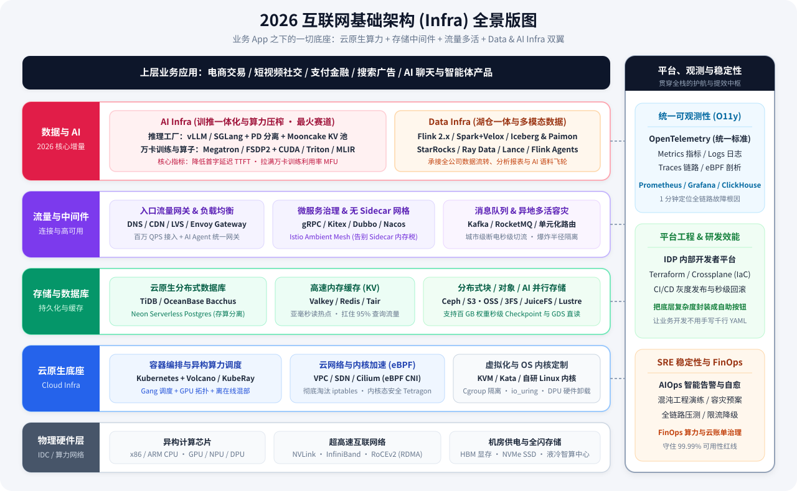
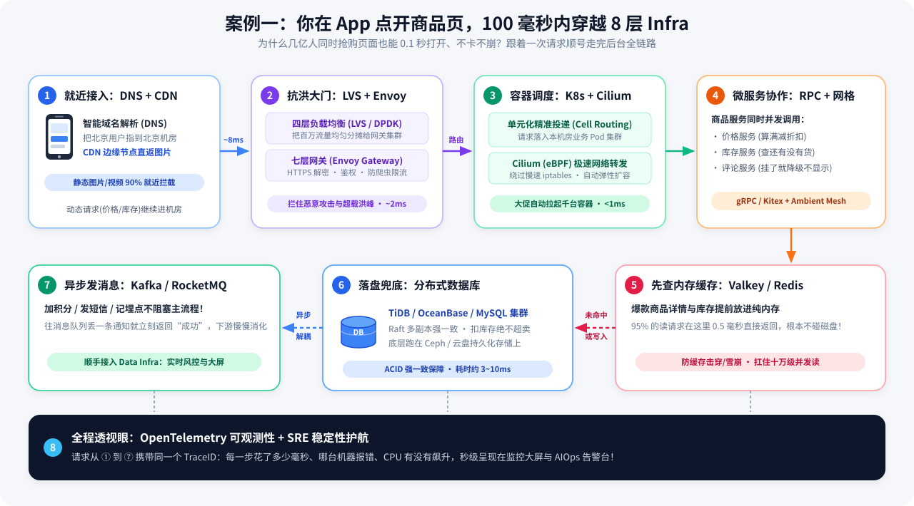
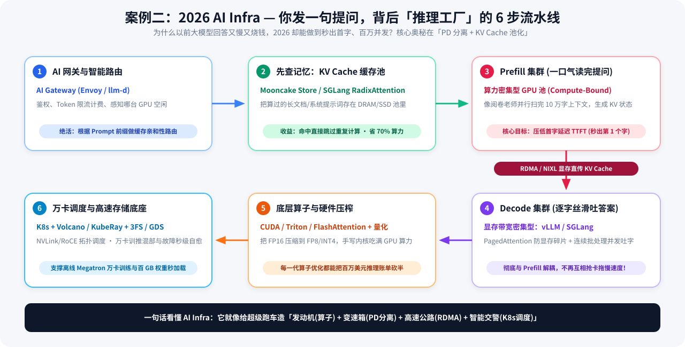
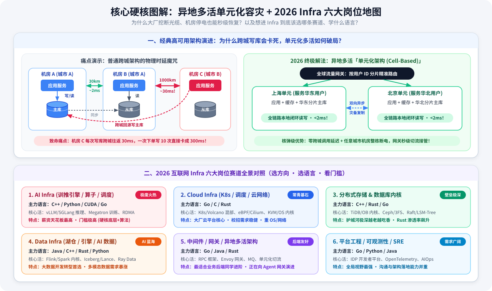

> **面向对象**：所有对互联网“基础架构（Infra）”感到好奇，想搞清楚 **Infra 到底包含哪些模块、和普通后端开发有什么区别、2026 年 AI 浪潮下 Infra 发生了什么巨变，以及校招/转行该怎么选方向和学语言** 的同学。  
> **阅读方式**：零基础友好，不堆砌黑话。全文配备 **4 张定制高清架构图**，通过两个编号真实案例把整张图串起来，最后附带 **2026 六大 Infra 岗位对照与 3 分钟速记表**。
{: .prompt-info }

---

## 导言：到底什么是互联网 Infra？（30 秒秒懂）

很多人听说大厂里有一群神秘的高薪工程师叫 **Infra（Infrastructure，基础架构工程师）**，但总觉得模模糊糊——他们和普通后端开发到底有什么区别？

用一座现代大都市做个最直白的比喻：
- **业务研发工程师（前端 / 业务后端）** = 在城市里**开商场、开餐厅、建游乐场**的人（负责写下单逻辑、做直播间礼物、开发社交动态、上线营销活动）。
- **Infra 基础架构工程师** = **建发电厂、铺国家电网、修高铁高架桥、建地下综合管廊和防震系统**的人！

用户平时逛商场时根本看不见地底下的高压电缆和自来水管——**只有在双十一停电了、春运抢票网站崩了、或者大模型排队转圈圈的时候，大家才会突然意识到基础设施有多重要。**

如果把时间拨到 **2026 年**，互联网 Infra 已经不再只是“管服务器、管数据库”那么简单了。随着 **云原生彻底成熟** 和 **AI 大模型全面爆发**，今天一线大厂的 Infra 版图已经演变成了一个庞大而精密的 **六层体系**。

---

## 第 1 章：一张图看懂 2026 互联网 Infra 的六大版图

先看全局全景图，记住这张图，以后无论听到 K8s、eBPF、Envoy、TiDB、Valkey、vLLM、PD 分离、异地多活、OpenTelemetry，你都能在 3 秒内知道它长在哪一层：

从下往上（从硬件到业务），用一句话串起每一层的职责：
1. **物理硬件层（地基）**：服务器 CPU、昂贵的 GPU/NPU 加速卡、超高速互联网络（NVLink / InfiniBand / RoCEv2）和液冷智算机房。
2. **Cloud Infra 云原生底座（算力池化）**：把成千上万台物理机虚拟化、容器化（**Kubernetes**），用 **eBPF/Cilium** 加速网络，用 **Volcano** 把算力像自来水一样按需分配给全公司。
3. **存储与数据库 Infra（持久化与缓存）**：负责让海量数据**存得下、不丢失、读得快**（云原生分布式数据库、内存缓存 **Valkey/Redis**、以及支撑大模型的超高速并行存储 **3FS / Ceph**）。
4. **流量网关、中间件与多活容灾（交通网与防震层）**：扛住每秒百万级入口流量（LVS / **Envoy Gateway**），管好成百上千个微服务之间的互相调用（RPC / **无 Sidecar 网格**），并在整座城市机房断电时实现**秒级异地切流**。
5. **Data Infra & AI Infra 双翼（2026 最大增量）**：
   - **Data Infra**：把海量业务日志与多模态数据变成报表、推荐特征和训练语料（湖仓一体、Flink/Spark、Ray/Lance）。
   - **AI Infra**：专门解决大模型“**算得动、装得下、扩得开、省下钱**”的工程难题（推理引擎 **vLLM/SGLang**、**PD 分离**、万卡训练与 CUDA 算子优化）。
6. **右侧横切护航中枢（平台工程、可观测性与 SRE）**：让业务开发不用手写复杂配置（IDP 内部开发者平台），用 **OpenTelemetry** 实时透视全链路，靠 **AIOps / 混沌工程 / FinOps** 守住 99.99% 可用性和云账单红线。

> **📌 第 1 章记忆锚点**：  
> 2026 年的互联网 Infra 已经从过去的“**以 CPU 和高并发 Web 为中心**”，全面演进为 **“传统云原生高可用底座 + AI 大模型训推算力工厂”双轮驱动**！
{: .prompt-tip }

---

## 第 2 章：编号实战串联 — 用 2 个真实案例走完 Infra 全链路

光看静态架构图容易抽象，下面我们用**编号拆解法（① → ② → ③ …）**，跟着**两次你在手机上最常见的操作**，看看背后的 Infra 是如何在几十毫秒内协同作战的。

---

### 案例一：你在电商 App 点开商品页，100 毫秒内穿越 8 层 Infra

晚上 8 点大促开启，几百万人同时在手机上点开同一款爆款手机的商品详情页，还要下单抢购。为什么页面能 **0.1 秒秒开** 且不会出现“100 台库存卖出去 105 台”的惨剧？顺着编号 ① → ⑧ 看图：

- **① 就近接入（DNS + CDN，约 8ms）**：
  - *发生了什么*：手机发出请求，**智能 DNS** 就像导航软件，根据你的地理位置把北京用户导向北京机房、广州用户导向广州机房；同时商品大图、详情页视频直接由离你小区最近的 **CDN 边缘节点** 返回，**90% 的静态大流量在这里就被就近拦截消化了**！
  - *如果没有它*：所有图片视频都挤进总部机房，机房带宽 1 秒就会被打爆。
- **② 抗洪大门（四层 LVS + 七层 Envoy Gateway，约 2ms）**：
  - *发生了什么*：查询实时价格、扣库存这种“动态请求”进入机房后，先经过 **四层负载均衡（LVS / DPDK）** 把百万并发均匀劈分给几十台网关；再由 **七层网关（Envoy Gateway）** 完成 HTTPS 解密、登录态鉴权、拦掉恶意爬虫，如果流量超过承受上限，直接触发限流保护（比如让你看到“前方拥挤请重试”），绝不让后台整体雪崩。
- **③ 容器调度与网络（Kubernetes + Cilium，不到 1ms）**：
  - *发生了什么*：网关通过**单元化路由**把请求精准送给本机房运行着的业务容器（Pod）。底层 **Kubernetes** 监测到双十一 CPU 飙升，提前自动把商品服务的容器从 50 个扩到 500 个；而 **Cilium（基于 Linux 内核黑科技 eBPF）** 绕过了老旧缓慢的 `iptables` 规则表，以接近物理网卡极限的速度把数据包送进容器！
- **④ 微服务协作（RPC 框架 + 无 Sidecar 服务网格）**：
  - *发生了什么*：一个商品详情页其实要同时展示价格、库存、优惠券和评价。后端通过高性能 **RPC 框架（gRPC / Kitex / Dubbo）** 并行向这几个微服务发请求。如果“评论服务”突然卡住了，服务治理层（**Istio Ambient Mesh**）会立刻触发**熔断降级**——暂时不显示评论区，确保你照样能顺畅下单！
- **⑤ 第一道加速盾：内存缓存（Valkey / Redis，约 0.5ms）**：
  - *发生了什么*：商品详情、活动价格这些被千万人反复查看的热点数据，早就提前放进了纯内存的 **Valkey / Redis** 集群里。内存读写比硬盘快几百倍，**95% 以上的读请求在这里 0.5 毫秒直接返回**，根本不打扰后面的数据库！
- **⑥ 落盘兜底：分布式数据库（TiDB / OceanBase / MySQL 集群，约 3–10ms）**：
  - *发生了什么*：当你真的点击“付款扣库存”时，必须落盘保证绝对准确。**TiDB / OceanBase** 这类分布式数据库通过 **Raft 一致性协议** 把数据同时写进多台机器的副本里，保证强一致事务（ACID），绝不超卖也不丢单；底层则跑在 **Ceph** 或云盘持久化存储上。
- **⑦ 异步削峰解耦（Kafka / RocketMQ）**：
  - *发生了什么*：下单成功后，还要给用户加积分、发短信通知、推送物流单、算实时大屏销量。如果全让用户干等着干完再提示“支付成功”，页面会卡好几秒！后端只要往消息队列里丢一条“订单已支付”消息就立刻返回成功，下游各个系统（包括 **Data Infra** 实时风控和大屏）各自按节奏异步消费。
- **⑧ 全程透视眼（OpenTelemetry + SRE）**：
  - *发生了什么*：你的这次请求从 ① 进门那一刻就被贴上了一个全局唯一身份证号（**TraceID**）。它在每一站花了多少毫秒、哪台机器报错了，全都通过 **OpenTelemetry** 实时汇总到监控大屏。哪怕出现 0.1% 的异常，值班 SRE 和 **AIOps** 系统在 1 分钟内就能精准定位到是哪台机器出了毛病！

---

### 案例二：2026 最火赛道 — 你给大模型发一句提问，背后「推理工厂」的 6 步流水线

理解了传统高并发 Web 请求，再来看 2026 年整个科技界最卷、最烧钱、也最缺人的 **AI Infra**。

当你给大模型扔进一篇 **10 万字的 PDF 论文**并问“帮我总结核心创新点”，后台其实运行着一座极其精密的 **LLM 推理工厂（Inference Factory）**。为什么传统做法会慢到卡死，而 2026 的架构能秒出第一个字？按编号 ① → ⑥ 看透核心黑科技：

在看这 6 步前，零基础同学只需先记住一个让人拍案叫绝的底层常识——大模型回答问题分两阶段，**性格完全相反**：
- **Prefill（预填充阶段）**：一口气把你输入的 10 万字全部并行读完并算出一堆中间记忆（叫 **KV Cache**）。这步极其吃 **GPU 计算力（Compute-Bound）**。
- **Decode（解码吐字阶段）**：一个字一个字地往外蹦答案，每蹦一个字都要把前面算好的巨型 KV Cache 从显存里搬出来看一遍。这步几乎不吃算力，全卡在 **GPU 显存搬运带宽（Memory-Bandwidth-Bound）** 上！

以前把这两个阶段硬塞在同一张 GPU 上跑，结果就是“新来一个长文档把所有人正在吐字的进度全部卡住”。**2026 年的 AI Infra 通过下面 6 步彻底解决了这个问题：**

- **① AI 网关与智能路由（AI Gateway / llm-d）**：
  - 不仅管登录鉴权和按 Token 计费，还能**感知每台 GPU 的实时排队长度和显存里缓存了哪些前缀**，把请求精准送到最合适的机器上。
- **② 先查记忆池：分布式 KV Cache（Mooncake Store / SGLang RadixAttention）**：
  - 很多用户问的问题都有相同的系统提示词（System Prompt）、相同的长文档或代码库。**Mooncake**（把整个集群闲置的 CPU 内存、高速 SSD 聚合成超大 KV 缓存池）和 **SGLang 的前缀树（RadixAttention）** 会先查一遍：如果这段上下文刚算过，直接复用现成的 KV Cache，**跳过重复计算直接省掉 70%+ 算力**！
- **③ Prefill 专属算力池**：
  - 如果缓存没命中，请求进入专门负责“猛算”的 Prefill GPU 集群，把并行计算吞吐压到极致，核心目标是把 **TTFT（Time-to-First-Token，首字延迟）** 压到秒级，让你感觉 AI 反应飞快。
- **④ RDMA / NIXL 显存直传 KV Cache**：
  - Prefill 算出来的 KV Cache 动辄几个 GB，怎么传给负责吐字的另一组机器？靠 **RDMA（InfiniBand / RoCEv2）** 和 **NVIDIA NIXL** 技术，完全绕过慢速的操作系统内核，实现**跨机器 GPU 显存到显存的微秒级直接搬运**！
- **⑤ Decode 专属吐字池（vLLM / SGLang）**：
  - 拿到 KV Cache 后，Decode 集群接棒逐字流式吐出答案。它靠两大法宝扛住超高并发：**PagedAttention**（像操作系统管虚拟内存一样把显存切页管理，彻底消灭显存碎片）+ **Continuous Batching（连续批处理，谁答完立刻插进下一个新请求，不让 GPU 傻等）**。
- **⑥ 底层算子压榨 + 万卡调度底座**：
  - 再往下，算子工程师用 **CUDA / Triton / FlashAttention** 和 **FP8/INT4 量化**把每一瓦电的算力榨干；而 **Kubernetes + Volcano / KubeRay** 负责管理上万张 GPU 卡的拓扑调度和离线 **Megatron** 分布式训练，配上 **3FS / GDS** 高速并行存储，实现几百 GB 模型权重的秒级加载与断点续传（Checkpoint）！

> **📌 第 2 章记忆锚点**：  
> - **传统互联网 Infra** 的核心矛盾是：**高并发、低延迟、绝不宕机**（靠 CDN + 网关 + K8s + 缓存 + 分布式 DB + 异步 MQ + 可观测性层层护航）。  
> - **2026 AI Infra** 的核心矛盾是：**极贵 GPU 的利用率与长上下文推理成本**（靠 **PD 分离 + KV Cache 池化 + RDMA 直传 + 算子量化 + 万卡调度** 把每一张显卡榨到极致）。
{: .prompt-info }

---

## 第 3 章：Cloud Infra（云原生底座）— K8s、eBPF 与离在线混部

看完了全链路，我们把中间最重要的 4 个核心领域拆开，用大白话讲透它们在 **2026 年最核心的技术演进**。

### 3.1 从买整台电脑 → 虚拟机 → 容器与 Kubernetes
- **以前（物理机时代）**：业务要上线，先向运维申请买服务器，等半个月装好系统，结果平时 CPU 只用掉了 10%，剩下 90% 全在吃灰交电费。
- **虚拟机（KVM）**：把一台 128 核大机器切成 16 台虚拟小电脑，但每台虚拟机都要装一整套操作系统，启动慢、占用内存多。
- **容器与 Kubernetes（K8s）**：容器就像**标准化集装箱**，只打包程序本身和依赖库，共享宿主机操作系统内核，**1 秒启动**！而 **Kubernetes** 就是管理十万个集装箱的“全自动港口总调度长”——机器坏了自动把容器搬到健康机器上，流量来了自动多复制几百份。

### 3.2 2026 云原生底座的 3 个硬核演进
1. **eBPF 与 Cilium 彻底淘汰老旧 `iptables`**：
   - 以前 K8s 里几万个容器互相通信靠 Linux 传统防火墙规则 `iptables`，容器一多就要一条条顺序匹配规则，延迟抖动极大。
   - **eBPF** 允许工程师在不修改 Linux 内核源码的前提下，把经过安全验证的高性能小程序直接挂进内核里执行！基于 eBPF 的 **Cilium** 已经成为 2026 年云原生网络的绝对事实标准，不仅转发速度起飞，还能顺手通过 **Tetragon** 在内核态实时拦截黑客入侵和容器逃逸。
2. **离在线混部（Colocation）—— 大厂省下数亿硬件费的绝招**：
   - 白天刷 App 的人多（在线微服务很忙），半夜几乎没人（CPU 利用率跌到 10%）。**Volcano** 等云原生调度器配合 Linux 内核 Cgroup 隔离，能把大数据离线分析、AI 离线推理安全地塞进在线服务器的空闲缝隙里“捡漏”；一旦白天在线流量激增，毫秒级把离线任务压制或驱逐，把全公司机房 CPU 平均利用率从 15% 拉升到 **50%+**！
3. **异构算力调度（GPU / NPU / DPU）**：
   - 传统 K8s 只懂 CPU 和内存。2026 年的调度器必须懂 **GPU 物理拓扑**（尽量把需要高频通信的 8 张卡调度在同一台机器的 NVLink 下，或者同一台高速交换机下）和 **Gang Scheduling（成组调度：要 64 张卡就一次全给齐，防止互相占一半死锁）**。

> **📌 第 3 章记忆锚点**：  
> Cloud Infra 的本质是**把硬件变成像水电一样的弹性算力池**。2026 必懂三件套：**Kubernetes（调度大脑）+ Cilium/eBPF（极速内核网络与安全）+ Volcano（离在线混部与 GPU 拓扑调度）**。
{: .prompt-tip }

---

## 第 4 章：存储与数据库 Infra — 存算分离、Valkey 与 AI 并行存储

数据是互联网公司的命根子。2026 年的存储与数据库基础设施呈现三大鲜明趋势：

### 4.1 分布式数据库：全面走向“云原生存算分离”
- **以前**：单台 MySQL 装不下怎么办？人工“分库分表”——把代码写得极其痛苦，跨表查询全废。
- **新一代分布式数据库（NewSQL / Serverless）**：
  - **TiDB**：天生水平扩展的分布式 SQL 数据库，通过 Raft 保证高可用，2026 年重点发力多租户弹性与 AI Agent 高并发持久化负载。
  - **OceanBase（Bacchus 架构）**：在金融级高可用（“三地五中心”容灾）的基础上，2026 年进一步推进**云原生共享存储与冷热分层**，把计算节点、共享块缓存和底层对象存储彻底解耦，大幅削减存储成本。
  - **Neon（Serverless Postgres）**：把关系型数据库的**计算节点完全无状态化**，底层通过写时复制（Copy-on-Write）对接共享存储。没人访问时可以**自动缩容到 0 不花一分钱（Scale-to-Zero）**，还能像 Git 一样秒级给整个数据库拉出一个测试分支！

### 4.2 内存缓存变天：Valkey 成为开源新主流
以前内存缓存几乎等于 Redis。但在 Redis 调整开源协议后，由 Linux 基金会牵头、各大云厂商共同维护的 **Valkey** 在 2025–2026 年迅速成为开源界接班人，100% 兼容原有生态且持续迭代多线程性能，扛起互联网高并发缓存、分布式锁和热点数据防线的重任。

### 4.3 底层存储：从通用 Ceph 到专为大模型打造的 3FS / GDS
- **Ceph**：企业私有云和 K8s 底座（Rook + Ceph）的统一存储老大哥，同时提供块存储（云盘）、文件存储和对象存储。
- **AI 高速并行存储（3FS / JuiceFS / Lustre + GPUDirect Storage）**：传统存储面对“10000 张 GPU 同时读几百 TB 训练数据，或者每半小时把几百 GB 模型权重存一次档（Checkpoint）”时会瞬间堵死，让昂贵的 GPU 陷入“饥饿”。2026 年像 **3FS** 这类极致吞吐的分布式文件系统配合 **GDS（数据从 SSD 绕过 CPU 直接送进 GPU 显存）**，已经成为大型智算集群的标配。

> **📌 第 4 章记忆锚点**：  
> 2026 存储与数据库记住三条线：**分布式关系库走向存算分离（TiDB / OceanBase Bacchus / Neon）**、**开源内存缓存转向 Valkey**、**底层存储分化为通用 Ceph 与 AI 极速并行存储（3FS / JuiceFS）**。
{: .prompt-tip }

---

## 第 5 章：流量网关、无 Sidecar 网格与异地多活单元化

这一层解决互联网最经典、也是架构师面试最爱考的难题：**怎么保证无论来多少流量、甚至整座城市机房被挖断光缆停电，App 依然丝滑可用？**

先看下面这张**异地多活与 2026 岗位全景对照图**的上半部分，一秒看懂为什么大厂要花巨大精力做“单元化”：

### 5.1 异地多活的核心痛点与“单元化”破局
看图上半部分的左右对比，你立刻就能“恍然大悟”：
1. **同城双活（左图机房 A ↔ 机房 B）**：同一个城市两个机房相距 30 公里，光纤来回只需 **~2 毫秒**，写库读库几乎无感。但如果这座城市遭遇地震、特大暴雨或全城断电，两个机房可能一起挂掉！
2. **朴素异地双活的物理魔咒（机房 B ↔ 机房 C）**：把机房 C 建在 1000 公里外的另一个城市。根据光速物理极限，光纤来回一次就要 **~30 毫秒**！如果机房 C 的应用每次下单都要跨城去写机房 A 的主库，一个下单流程写 10 次数据库，光网络往返就白白卡掉 **300 毫秒**，系统直接雪崩！
3. **2026 终极解法 — 单元化架构（Cell-Based Architecture，右图）**：
   - 把全国用户按用户 ID 切分成若干独立“单元（Cell）”：比如**上海单元**拥有完整的应用 + 缓存 + 华东分片主库，专门服务华东用户；**北京单元**拥有完整副本，专门服务华北用户。
   - **平时**：华东用户的读写 100% 在上海本地闭环完成（延迟 **&lt;2ms**），完全没有跨城调用！两个城市后台做异步双向灾备复制。
   - **灾难来临时**：万一上海机房整栋停电，全球流量网关在**秒级**把原本发往上海的华东用户流量切到北京单元接管，用户几乎感知不到故障！

### 5.2 2026 网关与服务网格的两大新变化
1. **告别 Sidecar 内存税 → 无 Sidecar 架构（Istio Ambient Mesh）**：
   - 过去几年流行“服务网格（Service Mesh）”，给每个业务容器旁边硬塞一个叫 **Sidecar（边车）** 的代理小弟负责加密和限流。结果集群有 10 万个容器就多了 10 万个代理小弟，白白吃掉成百上千台机器的内存！
   - 2026 年主流已转向 **Ambient Mesh（无边车模式）**：每台物理机只共用一个轻量级四层代理（`ztunnel`），需要复杂七层治理时再按需过共享的 Waypoint 代理，资源开销断崖式下降。
2. **入口网关统一化：Envoy Gateway + AI Agent Gateway**：
   - 基于 K8s Gateway API 标准的 **Envoy Gateway** 正在取代传统 Nginx Ingress；同时为了迎接 AI 时代，网关层长出了专门处理大模型流式输出（SSE）、Token 限流与多工具（MCP）路由的 **AI / Agent Gateway**。

> **📌 第 5 章记忆锚点**：  
> 记住两个数字看透高可用：**同城 30km ≈ 2ms，异地 1000km ≈ 30ms**。想突破光速魔咒实现城市级容灾，必须靠 **单元化异地多活（数据与流量按用户分片本地闭环）**；微服务治理则记住 **Envoy Gateway + 无 Sidecar（Ambient Mesh）**。
{: .prompt-tip }

---

## 第 6 章：平台工程、可观测性与 SRE — 十万台机器的大管家

底层技术越强，配置就越复杂——业务开发不可能为了上线一个新接口，自己去写 500 行 K8s YAML、配 Cilium 网络策略、配 Envoy 路由和监控告警！于是 2026 年诞生了三个非常成熟的横切体系：

1. **平台工程（Platform Engineering）与 IDP（内部开发者平台）**：
   - 把“基础设施当成产品来做”！底层用 **Terraform / Crossplane** 统一管理云资源，向上封装成一个极简的自助网页或 CLI 按钮：业务同学点一下“新建微服务”，平台自动建好代码库、CI/CD 流水线、K8s 集群、灰度发布和监控大屏。
2. **统一可观测性（Observability）— OpenTelemetry 一统江湖**：
   - 以前监控指标用一套工具、查日志用另一套、看调用链又用第三套，数据全打不通。**OpenTelemetry（OTel）** 统一了 **Metrics（指标）、Logs（日志）、Traces（链路追踪）** 和 **Profiling（性能剖析）** 的采集标准，结合 eBPF 做到业务代码**零侵入自动埋点**，故障定位效率提升数倍。
3. **SRE 稳定性工程、AIOps 与 FinOps**：
   - **混沌工程（Chaos Engineering）**：平时就主动在生产环境演练“故意拔掉某台服务器网线、注入 500ms 延迟”，提前暴露隐患（打预防针）。
   - **AIOps**：2026 年大厂值班告警台普遍接入了运维大模型智能体——半夜报警响起时，AI 自动拉取链路日志和最近代码变更，把“最可能的根因 + 一键回滚方案”直接推到值班工程师手机上。
   - **FinOps**：把每台机器、每个 GPU 和每 GB 存储的成本精确算清并自动优化闲置资源。

> **📌 第 6 章记忆锚点**：  
> 平台工程解决 **“业务好用”**（IDP 屏蔽复杂度），OpenTelemetry 解决 **“系统透明”**（指标日志链路合一），SRE + AIOps + FinOps 解决 **“绝不宕机 + 不乱花钱”**。
{: .prompt-tip }

---

## 第 7 章：2026 互联网 Infra 六大岗位赛道与求职避坑指南

如果你正在规划校招、实习或职业转型，上面第 5 章配图的下半部分已经画出了 **2026 互联网 Infra 的六大核心赛道**。这里帮你把每个方向的**真实行情、语言分工和备战路线**彻底讲透：

### 7.1 六大岗位赛道全景对比

| 赛道方向 | 日常核心工作 | 2026 招聘热度与薪资 | 入门门槛与适合人群 |
| :--- | :--- | :--- | :--- |
| **1. AI Infra**（训推引擎 / 算子 / AI 调度） | vLLM / SGLang 推理加速、PD 分离、Megatron 万卡训练、CUDA/Triton 算子、GPU 调度 | **🔥 极度火热 · 薪资天花板最高** | **门槛极高**：适合 C++/Python 功底扎实，愿意啃 GPU 硬件架构、NCCL 通信与分布式系统源码的硬核同学。 |
| **2. Cloud Infra**（K8s / 调度 / 云网络 / 内核） | K8s 调度器、Volcano 离在线混部、eBPF/Cilium、VPC 网络、虚拟化与 OS 内核 | **稳健常青 · 大厂云部门核心** | **门槛中高**：非常适合 Go / C 功底好、对操作系统和计算机网络有浓厚兴趣的同学。 |
| **3. 存储与数据库 Infra** | TiDB / OceanBase / Postgres 内核、Ceph / 3FS 分布式存储、LSM-Tree / Raft | **壁垒极深 · 越老越吃香** | **门槛高**：适合耐得住寂寞、喜欢啃 CMU 15-445 / MIT 6.824 等硬核底层课程的同学。 |
| **4. Data Infra**（湖仓 / 计算引擎 / AI 数据） | Flink / Spark 内核、Iceberg / Paimon / Lance、Ray Data、流式 Agent 运行时 | **🚀 AI 多模态分支需求暴涨** | **门槛适中偏高**：非常适合懂大数据生态（Java/Python/C++）且想向 AI 数据飞轮跃迁的同学。 |
| **5. 中间件 / 网关 / 异地多活** | RPC 框架、Envoy / Agent Gateway、消息队列、单元化切流与高可用治理 | **传统增量放缓 · 向 AI 网关转型** | **最适合后端开发平滑进阶**：业务后端同学想转 Infra，这是落差最小、最容易切入的桥梁。 |
| **6. 平台工程 / 可观测性 / SRE** | IDP 内部平台、OpenTelemetry 监控链路、CI/CD、混沌工程、AIOps 与 FinOps | **需求面最广 · 几乎所有中大厂都有** | **综合友好**：重视全局架构视野、工程落地与排障能力，Go / Python / Java 均可切入。 |

---

### 7.2 2026 Infra 界编程语言的“江湖分工”

很多同学纠结该学哪门语言，其实在 2026 年的 Infra 领域，五门语言的分工已经极其清晰：
- **C++（极致性能的基石）**：AI Infra 推理/训练底层、CUDA 算子、高性能数据库与存储引擎、搜索引擎的绝对主力，永远不过时的硬通货。
- **Go（云原生时代的“普通话”）**：Kubernetes 生态、云原生控制面、容器调度器、网关、微服务中间件、平台工程的统治级语言。写并发极其爽快，校招切入 Cloud Infra / 平台工程性价比最高。
- **Rust（上升势头最猛的超级新星）**：兼顾 C++ 的极限性能与编译期内存安全（没有 GC 卡顿、也没有内存泄漏和段错误），正在数据库（TiKV / DataFusion）、AI 数据引擎（Daft / Lance）、安全网关与云原生数据面疯狂攻城略地，简历上有扎实 Rust 项目极具差异化溢价！
- **Java（大数据与传统中间件大本营）**：在 Flink / Spark / Kafka / Iceberg 等大数据基础设施与传统大厂 Java 中间件生态依然稳固，但在纯云原生底座和 AI Infra 中占比极小。
- **Python（AI Infra 的“胶水与前端”）**：大模型训练框架（PyTorch）、推理引擎上层编排（vLLM / SGLang / Ray）以及 AIOps 工具大量使用 Python（通常需要搭配 C++ 或 Go 一起掌握）。

---

### 7.3 给零基础/入门同学的 4 步成长路线

想从普通开发者真正跨进 Infra 大门，不需要把六层全学会，按这 4 步走最稳妥：
1. **死磕三大计算机内功（面试永恒的 60% 分数）**：
   - **操作系统**：进程/线程、锁与无锁并发、虚拟内存与 Page Cache、I/O 多路复用（`epoll` / `io_uring`）、零拷贝（`sendfile` / `mmap`）。
   - **计算机网络**：TCP 拥塞控制与状态机、HTTP/2 & HTTP/3、DNS/负载均衡原理，进阶了解 eBPF 与 RDMA 概念。
   - **分布式系统**：共识算法（Raft / Paxos）、分布式事务与幂等、CAP/一致性模型、高可用与容灾设计。
2. **选定 1 门主语言 + 1 条细分赛道**：比如“Go + Cloud Infra/K8s 控制面”、“C++/Python + AI Infra 推理/调度”、或“Java/C++ + Data Infra 引擎与湖仓”。
3. **亲手写一个硬核系统轮子**：比起十个增删改查业务项目，亲手实现一个 **基于 Raft 的迷你 KV 存储（如 MIT 6.824）**、**迷你 K8s Operator**、**轻量 RPC/网关** 或 **手写简化版 PagedAttention/推理调度器**，含金量直接拉满。
4. **去真实的开源社区“拿 PR 说话”**：Infra 界极其认可开源贡献！去 Kubernetes、vLLM、SGLang、Apache Flink、TiKV、Envoy、OpenTelemetry 等活跃仓库修几个真实 Bug 或补一个特性，既能逼自己读懂工业级代码，又是最硬核的面试敲门砖。

---

## 🔖 附：2026 互联网 Infra 全景 3 分钟速记总表

| Infra 板块 | 解决什么核心问题？ | 2026 必懂核心技术 / 开源代表 | 一句话记忆口诀 |
| :--- | :--- | :--- | :--- |
| **Cloud Infra（云原生）** | 把万台物理机池化并极致压榨利用率 | **Kubernetes**、**Volcano / KubeRay**、**Cilium (eBPF)**、KVM、离在线混部 | K8s 管集装箱，**eBPF 替代 iptables**，Volcano 搞**混部与 GPU 调度** |
| **存储与数据库** | 海量数据存得下、不丢不乱、毫秒级读 | **TiDB / OceanBase Bacchus / Neon**、**Valkey**、**Ceph / 3FS / GDS** | 分布式库**存算分离**，缓存换 **Valkey**，大模型存储看 **3FS/GDS** |
| **流量、网格与多活** | 扛住百万并发 + 整城断电秒级容灾 | **LVS / Envoy Gateway**、**Istio Ambient Mesh**、gRPC/Kitex、**单元化多活** | 网关抗洪，网格**去 Sidecar 省内存**，多活靠**单元化本地闭环**破光速魔咒 |
| **AI Infra（最火）** | 压低大模型首字延迟、榨干万卡 GPU | **vLLM / SGLang**、**PD 分离**、**Mooncake KV 池**、RDMA/NIXL、Megatron/CUDA | 推理靠 **PD 分离 + KV 池化 + RDMA**，底层靠 **CUDA 算子与量化**砍账单 |
| **Data Infra** | 让全公司业务与多模态数据变成价值 | **Iceberg / Paimon / Lance**、**Flink 2.x**、**Spark+Velox**、StarRocks、Ray Data | 存算分离湖仓一体，计算**逃离 JVM**，多模态靠 **Lance + Ray** 转飞轮 |
| **平台、观测与 SRE** | 屏蔽底层复杂度 + 守住 99.99% 稳定性 | **IDP (Crossplane/Terraform)**、**OpenTelemetry**、混沌工程、**AIOps / FinOps** | 平台工程做自助按钮，**OTel 统一度量追踪**，AIOps+FinOps 保稳又省钱 |
