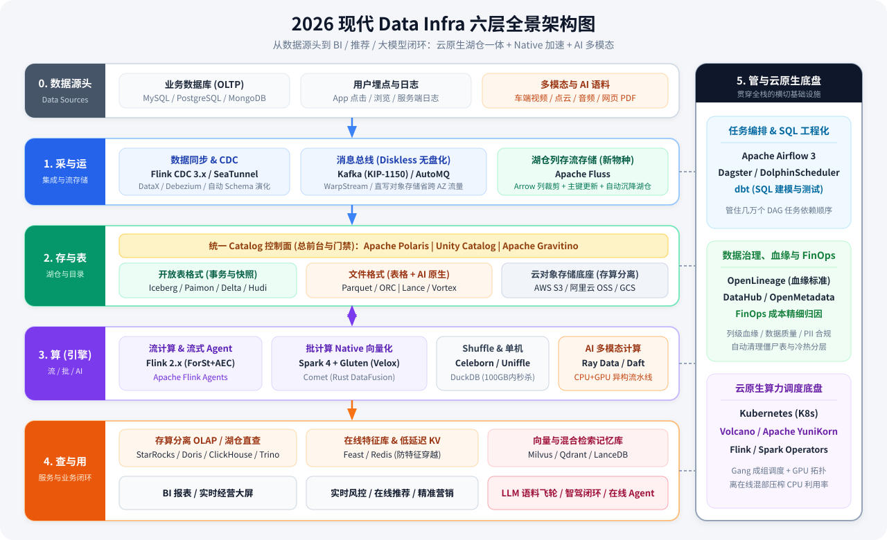
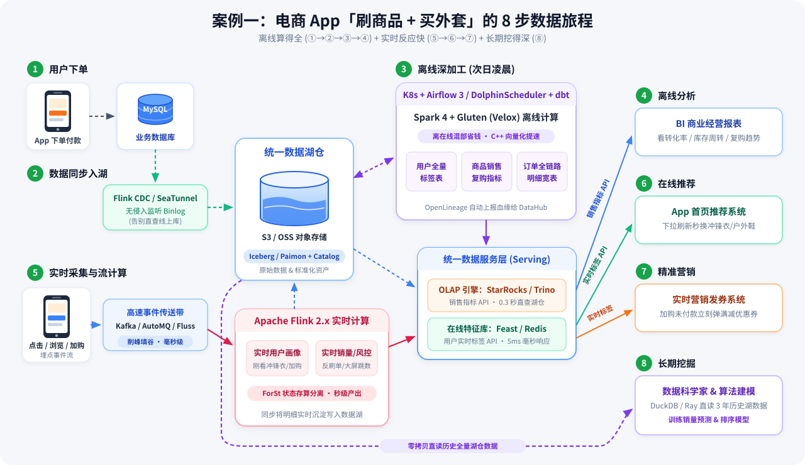
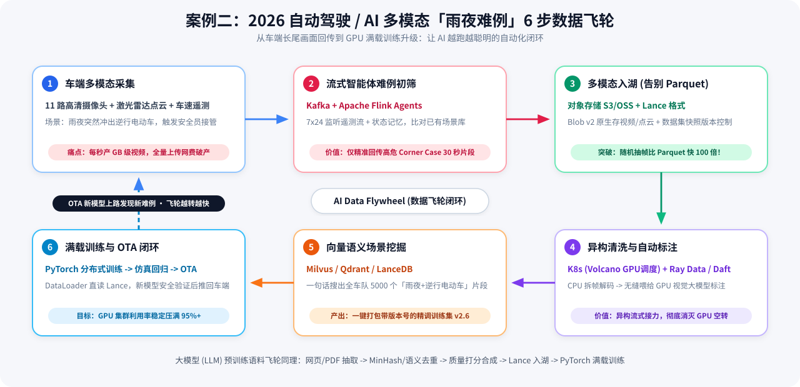
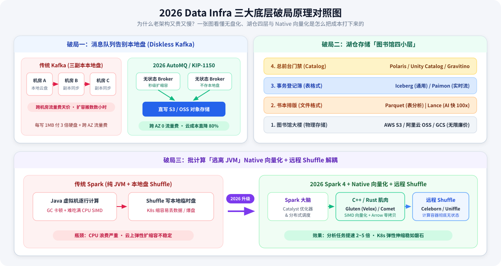
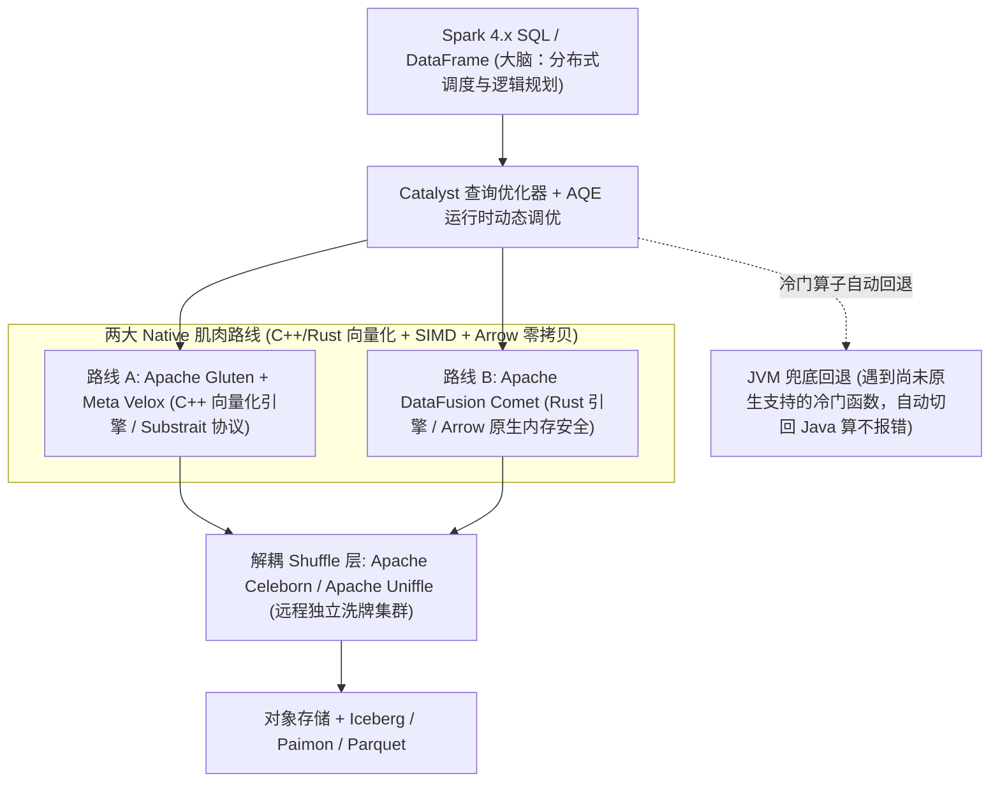

> **面向对象**：所有对大数据、AI 基础设施感兴趣，想搞清楚 **Data Infra（数据基础设施）到底在干什么、每一层都有什么组件、它们如何协同运转** 的入门同学。  
> **阅读收获**：不假设你背过任何专业名词。每个陌生概念都会先用**生活类比**讲透，再落到 **2026 年一线互联网与 AI 公司正在用的真实开源架构**，最后附带**大厂团队分工**与 **3 分钟速记表**，方便反复回看。
{: .prompt-info }

---

## 导言：到底什么是 Data Infra？（30 秒秒懂）

想象一座拥有 2000 万人口的超级大都市，每天每家每户都要用水：
- **业务后端工程师** = 在商场、小区里建房子、装水龙头的人（负责让你在 App 里下单、刷视频、发朋友圈）。
- **数据分析师 / 算法工程师** = 用干净的自来水做饭、泡茶、酿酒的厨师（负责画经营报表、训练推荐系统和大模型）。
- **Data Infra（数据基础设施工程师）** = **修水库、铺跨城大水管、建全自动净水厂、建智能水压调度中心的人**！

当一家公司只有 1 万用户时，一台 MySQL 数据库就能搞定一切，根本不需要 Data Infra。  
但当用户变成 **1 亿人**，每天产生 **几百 TB 的点击日志、交易订单、甚至自动驾驶的高清视频** 时，单台数据库瞬间就会被撑爆。

**Data Infra 要解决的，就是全公司在“海量数据”场景下的 6 个终极问题：**
1. **怎么收？**（把散落在成百上千个数据库、手机 App、传感器里的数据安全运出来）
2. **怎么存？**（便宜地存下 PB 级数据，还能像数据库一样增删改查、不丢不乱）
3. **怎么算？**（几百亿条数据、几百万段视频，怎么用成百上千台机器又快又省钱地算完）
4. **怎么查？**（老板点开报表、推荐系统挑商品、AI 搜记忆，怎么做到毫秒级出结果）
5. **怎么管？**（成千上万个任务谁先跑谁后跑？机器资源怎么分配？出了错找谁？花了多少钱？）
6. **怎么喂给 AI？**（2026 年的新命题：怎么把海量文字、图片、视频高效洗干净喂给大模型和智能体？）

下面，我们先用 3 分钟看懂 Data Infra 是怎么一步步长成今天这个样子的，再跟着**两条真实数据走完一生**，最后把 2026 年现代架构的 **6 大核心层** 逐层拆开讲透。

---

## 第 1 章：Data Infra 的三次代际跃迁（为什么今天长这样？）

很多同学刚入门大数据时最大的困惑是：“怎么满屏都是英文单词——HDFS、S3、Kafka、Spark、Flink、Iceberg、K8s、Ray……它们谁和谁是一伙的？”

其实只要看懂过去 20 年的**三次架构大换代**，所有组件的位置瞬间就清晰了。我们可以把数据平台比作一家**大型食品加工厂**：

### 第一代（2006–2016）：Hadoop 存算一体时代 — “每台机器既是仓库又是厨房”
- **核心代表**：HDFS（分布式文件系统）+ YARN（资源调度）+ MapReduce / Hive（计算）。
- **当时的想法**：20 年前机房网络很慢，把数据传来传去太耗时，于是干脆把**存储（硬盘）和计算（CPU）死死绑在同一台机器上**——数据存在哪台机器，就在哪台机器上直接算。
- **后来为什么撑不住了？**
  - **扩缩容极其浪费**：双十一大促算力不够，必须连带着买一堆装满硬盘的新机器；平时不忙，机器全在闲置烧钱。
  - **不能改只能重算**：早期的 HDFS 文件写进去就不能原地修改。哪怕只改了一条订单状态，也要把一整天几百 GB 的文件全量重写一遍。
  - **实时和离线割裂**：离线算一天前的账用一套系统（Hive/Spark），实时算刚才 1 分钟的数据又得另写一套代码，两边结果还经常对不上。

### 第二代（2017–2023）：云原生“湖仓一体”时代 — “中央冷链大仓库 + 随叫随到的外包厨师”
- **核心代表**：对象存储（S3/OSS）+ 开放表格式（Iceberg / Paimon / Delta）+ Spark / Flink + Kubernetes（K8s）。
- **核心革命：存算分离！** 后来机房网卡升级到了百 G 高速网络，传数据不再是瓶颈，于是大家把“存”和“算”彻底拆开：
  - **存**：所有数据统一丢进云端**对象存储**（你可以理解成一个无限大、贼便宜的超级网盘），上面再加一层“开放表格式”当智能账本，让网盘也能支持事务、增删改和历史版本回溯。
  - **算**：计算集群变成无状态的“外包厨师”，跑在 **Kubernetes（容器编排系统）** 上。有任务来时 10 秒钟拉起 1000 个计算容器，干完活立刻销毁停止计费。

### 第三代（2024–2026）：Native 极致提速 + AI 多模态时代 — “自动化超级工厂”
进入 2025–2026 年，第二代架构又遇到了三个新瓶颈，催生了今天的 **2026 现代 Data Infra**：
1. **Java 太重、云账单太贵**：传统大数据引擎大多用 Java 写，内存开销大、垃圾回收（GC）会卡顿；传统消息队列在云上跨机房同步流量费贵到离谱。
   - 👉 **2026 解法**：计算引擎把核心运算换成 **C++ / Rust 底层加速**（Velox / DataFusion）；消息队列告别本地硬盘，直接写对象存储（**Diskless Kafka**）；流计算引擎也实现状态存算分离（**Flink 2.x ForSt**）。
2. **工具太多，谁来统一管权限和目录？**：同一份数据，Spark 要读、Flink 要写、BI 工具要查、AI 训练也要拉，各管各的乱成一锅粥。
   - 👉 **2026 解法**：把 **Catalog（统一元数据目录）** 升级成全公司唯一的总前台与门禁（Apache Polaris / Unity Catalog / Apache Gravitino）。
3. **AI 时代来了，表格不再是全部**：以前 Data Infra 只处理规整的“行和列”（比如订单表）；现在大模型、自动驾驶、具身机器人每天产出海量**网页文本、4K 视频、激光雷达点云、音频和向量**，传统工具根本吃不动。
   - 👉 **2026 解法**：长出了一整套 **AI-Native 数据栈**——多模态文件格式 **Lance**、异构计算引擎 **Ray Data / Daft**、向量检索库 **Milvus / Qdrant**，以及实时流式智能体运行时 **Apache Flink Agents**。

### 2026 现代 Data Infra 六层全景架构图

> **📌 第 1 章记忆锚点**：  
> 20 年演进记 3 个词就够了：**存算一体（Hadoop）→ 存算分离湖仓（S3 + Iceberg/Paimon + K8s）→ 2026 Native 提速 + AI 多模态化（C++/Rust 加速 + Diskless + Lance/Ray/Agent）**。
{: .prompt-tip }

---

## 第 2 章：全景串联 — 用 2 个真实案例，编号走通现代 Data Infra 全链路

光看六层架构框图，零基础同学很容易“每个词都眼熟，连在一起就发懵”。下面我们用**编号拆解法（① → ② → ③ …）**，手把手带你看懂两个最经典的真实业务场景：**一个是大家每天都在用的电商 App，一个是 2026 年最前沿的自动驾驶/AI 系统**。

---

### 案例一：你在电商 App 上“刷商品 + 买外套”的 8 步数据旅程

想象这样一个再普通不过的画面：晚上 8 点，你在手机上刷电商 App，看了三件冲锋衣，把其中一件加入购物车，最后花 299 元买下了一件外套。

你以为只是点了几下屏幕，但在后台，这几下点击瞬间触发了 **离线 + 实时 + 挖掘** 三条互相配合的完整链路（按编号 ① → ⑧ 顺着看图）：

下面按编号一步步看懂，**每一步到底在干嘛、2026 年用什么主流组件、如果没有这一步会怎样**：

- **① 用户下单（数据诞生）**：
  - *发生了什么*：你付款后，交易系统往 **MySQL**（业务数据库）写了一条订单记录。
  - *为什么不能直接拿 MySQL 做大数据分析？* MySQL 忙着应付每秒几万笔真实下单，如果老板直接在上面跑一条“统计过去 3 年全国销售额”的大查询，MySQL 瞬间卡死，全网用户都没法下单了！所以必须把数据搬出来算。
- **② 数据同步入湖（把数据搬进大仓库）**：
  - *发生了什么*：用 **Flink CDC**（实时监听 MySQL 变更日志）或 **SeaTunnel / DataX**（定时批量同步），无侵入地把业务库里的订单数据同步进**数据湖**（底层是便宜的对象存储 S3/OSS，上面套着 **Iceberg / Paimon** 开放表格式）。
  - *这一步的价值*：既不打扰线上 MySQL 做生意，又把全公司所有业务库的原始数据统一沉淀到了同一个“超级大仓库”里。
- **③ 离线深加工（每天凌晨算大账）**：
  - *发生了什么*：每天凌晨 2 点，调度平台（**Airflow 3 / DolphinScheduler**）按任务依赖顺序，通过 **Kubernetes** 拉起 **Spark 4（配合 C++ Velox 加速）** 集群，从数据湖里读出昨天几十亿条订单、物流、退货记录，加工成干净规整的**“订单宽表”、“商品销售指标”、“用户全量标签”**，用 **dbt** 做完质量校验后再存回湖仓。
  - *为什么叫离线？* 因为算一整天全局复杂的账（比如 30 天复购率、跨品类交叉统计）数据量极大，没必要每秒算一次，凌晨算好最省钱、最准确。
- **④ 离线分析（老板与运营看 BI 报表）**：
  - *发生了什么*：早上 9 点运营同学打开 **BI 报表**，后台通过 **StarRocks / Trino** 直接高速读取加工好的销售指标和湖仓表，0.3 秒画出“昨日各省份转化率与库存周转率”趋势图，辅助进货和定价决策。
- **⑤ 实时采集与流计算（盯紧此时此刻！）**：
  - *发生了什么*：你刚在 App 里点看了 3 件冲锋衣、加购了 1 件。这些行为埋点等不到明天凌晨再算！它们毫秒级发到 **Kafka / AutoMQ / Apache Fluss**（高速传送带），由 **Apache Flink 2.x** 实时消费，1 秒内更新出你的**“实时兴趣画像（刚看冲锋衣）”**、更新**“实时大屏销量”**，同时把明细顺手沉淀进数据湖。
- **⑥ 在线推荐（刷一下首页立刻变准）**：
  - *发生了什么*：Flink 把你最新的实时标签写入 **Redis / Feast（在线特征库）**。1 秒后你下拉刷新 App 首页，推荐系统调一次“用户实时标签 API”（耗时不到 5 毫秒），首页立刻给你推更合心意的户外鞋和冲锋衣，而不再推你刚买过的那件外套！
- **⑦ 精准营销（趁热打铁促成交）**：
  - *发生了什么*：营销系统同样监听你的实时标签 API——发现你把冲锋衣加进了购物车却迟迟没付款，立刻自动弹出一张“户外专场满 300 减 30”的限时优惠券，大幅提升成交转化率。
- **⑧ 长期挖掘（数据科学家训练预测模型）**：
  - *发生了什么*：数据科学家和算法工程师直接从数据湖读取**过去 3 年的历史全量数据**（不需要再找研发临时导表），用 **DuckDB / Spark / Ray** 训练销量预测模型和推荐排序模型，持续优化全公司的转化率和库存周转率。

> 看到这里你应该瞬间明白了：所谓“数据平台”，绝不是一堆孤立的工具，而是 **让离线算得全（①→②→③→④）、实时反应快（⑤→⑥→⑦）、历史挖得深（⑧）** 三条线围绕着**同一个数据湖仓**完美咬合！

---

### 案例二：2026 AI 前沿 — 自动驾驶车队“雨夜难例视频”的 6 步数据飞轮

看完了传统互联网电商，再来看一个 2026 年最炙手可热的 **多模态 AI Data Infra** 案例。

一辆自动驾驶测试车在雨夜行驶时，突然冲出一辆逆行电动车，安全员紧急踩了刹车（触发“人类接管”）。这段珍贵画面是如何让全车队变聪明的？

按编号 ① → ⑥ 拆解这一套 2026 AI 闭环：
- **① 车端采集**：车上摄像头和激光雷达每秒产出 GB 级非结构化数据，全量传回云端网费会破产。
- **② 流式难例初筛**：关键遥测事件进入 **Kafka + Apache Flink Agents**，流式智能体实时判断这是否属于罕见“长尾难例（Corner Case）”，只把有价值的 30 秒片段触发回传。
- **③ 多模态入湖（告别传统表格格式）**：视频、点云和元数据一起写进 **对象存储 + Lance 格式**。普通表格文件（Parquet）随机抽一帧视频极慢，而 Lance 专为 AI 打造，支持毫秒级随机读和版本追溯。
- **④ 异构清洗与自动标注**：**Ray Data / Daft** 跑在 **K8s + Volcano（GPU 调度器）** 上，CPU 节点一边拆帧解码，一边流式喂给 GPU 节点跑视觉大模型自动画标注框，绝不让昂贵的 GPU 空转。
- **⑤ 向量相似挖掘**：画面特征转为向量存入 **Milvus / Qdrant**。工程师一句话搜出全国车队里 5000 个类似“雨夜+电动车逆行”的片段，打包成一个带版本号的训练集。
- **⑥ 满载训练与 OTA 闭环**：PyTorch 直接高速流式读取 Lance 数据集，把 GPU 利用率压满到 **95%+** 训出新模型，仿真测试通过后推送回车端——这就是让 AI 越用越聪明的 **数据飞轮（Data Flywheel）**。

> **📌 第 2 章记忆锚点**：  
> 2026 的现代 Data Infra 跑着两条并排的高速公路：**案例一是结构化业务数据（离线算全 ①-④ + 实时反应 ⑤-⑦ + 长期挖掘 ⑧），案例二是多模态 AI 数据飞轮（①-⑥ 喂满 GPU 持续进化）**。而两条路脚下共用同一套对象存储、统一目录和 Kubernetes 算力底盘！
{: .prompt-info }

---

## 第 3 章：第 1 层「采与运」— 数据集成与流存储

这一层干两件事：**把散落各处的数据“抽出来”**（数据集成），以及**放上传送带“稳稳运给下游”**（消息队列与流存储）。

### 3.1 数据集成（Ingestion）：怎么把几百个业务库的数据搬进数据平台？

把分散在各个业务线里的 MySQL、PostgreSQL、MongoDB 想象成几百个分店的账本，要把它们统一搬进总仓库，主流有四种“搬家方式”：

| 工具 | 生活类比 | 核心原理（人话版） | 2026 适用场景 |
| :--- | :--- | :--- | :--- |
| **DataX** | **卡车定时拉货** | 经典的单机多线程同步工具。每天定时启动一次，把源数据库表分页读出来写进目标库。 | 简单轻量的**离线批量同步**；局限是不支持实时流，大规模集群化部署时需要外围自己配合调度系统管理分片和失败重试。 |
| **Apache SeaTunnel** | **现代化专业物流公司** | 新一代分布式数据集成引擎，自带轻量级 **Zeta 引擎**（也能跑在 Flink/Spark 上），支持上百种数据源，批流统一。 | 2026 国内最火的 DataX 升级替代方案，同时搞定 TB 级高速离线同步与多表实时同步。 |
| **Flink CDC 3.x** | **实时速记员 + 自动改表头** | 直接监听数据库底层变更日志（CDC = Change Data Capture，变更数据捕获），先无锁抄一遍存量数据，再无缝衔接毫秒级增量变更；3.x 原生支持**整库同步**和 **Schema Evolution（上游业务表加了一列，下游湖仓自动跟着加列不报错）**。 | **实时数据入湖/入仓的行业首选**，彻底告别“业务改表结构导致半夜数仓大面积报警”的痛点。 |
| **Debezium** | **专注抄账本的采集器** | 跑在 Kafka Connect 生态上，专职把数据库变更转成标准事件流发给 Kafka。 | 海外云原生体系（AWS / Confluent 等）最常见的 CDC 组件。 |

---

### 3.2 消息总线与流存储的 2026 巨变：为什么传统 Kafka 正在进化？

过去十几年，**Apache Kafka** 几乎就是“消息队列”的代名词：上游把事件源源不断写进 Kafka，下游十几个消费方各自按自己的速度读，互不干扰。

但在 2025–2026 年的云上环境，传统 Kafka 碰到了两个很疼的问题，催生了两大技术演进：

#### 演进一：告别本地硬盘与天价跨机房流量费 → Diskless Kafka（无盘化）
- **痛点（人话）**：传统 Kafka 怕服务器硬盘坏掉丢数据，每收到 1MB 数据，都要在 3 个不同机房（可用区 AZ）的本地硬盘上各存一份副本。公有云上“跨机房传流量”和“买高性能云盘”非常贵，大厂光是 Kafka 的云账单一年就能烧掉几百万。而且机器扩容时，要搬运几十 TB 的老数据，耗时好几个小时。
- **2026 解法**：**让 Kafka 节点不再存本地盘（变无状态），数据攒几百毫秒直接一把写进廉价的对象存储（S3/OSS）！** 对象存储天生自带跨机房高可靠，同区域读写还不收跨机房流量费，扩容几秒钟完成！
- **三大代表**：
  - **WarpStream**（被 Confluent / IBM 收购）：Go 语言重写的无盘 Kafka 先驱。
  - **AutoMQ**：基于原生 Kafka 源码开源改造（Apache 2.0），高度兼容 Kafka 协议，底层存储换成 S3/共享盘，大幅压低云上存储与流量成本。
  - **Kafka 官方 KIP-1150 / KIP-1163**：Apache Kafka 社区也在积极推进“无盘主题（Diskless Topics）”架构演进，加上已取代 ZooKeeper 的 **KRaft** 模式，官方原生 Kafka 正在全面云原生化。

#### 演进二：从“按行顺序传送带”进化成“列存流存储” → Apache Fluss
- **痛点（人话）**：Kafka 只能像磁带一样“按整条记录从头往后顺着读”。如果一条订单有 100 个字段，下游 Flink 只想算金额（`price`）这一列，也必须把整条 100 个字段全拉下来解析，白白浪费 90% 带宽；而且 Kafka 不能按主键（比如 `order_id`）直接更新某一行，导致下游 Flink 必须自己在本地存几个 TB 的状态硬扛去重和关联。
- **2026 新物种 — Apache Fluss**：
  - 专为实时湖仓设计的**列存流存储**（底层用 Apache Arrow 按列组织内存）。
  - **三大绝活**：① **服务端列裁剪**（你要哪两列我只给你传哪两列，省 80% 流量）；② **原生主键表 & 部分列更新**（多条业务流直接往同一张主键表里填不同字段，Fluss 帮你拼好宽表，大幅减轻 Flink 状态负担）；③ **自动冷热分层入湖**（最近几小时热数据在 Fluss 提供亚秒级流读，老数据自动沉降成 **Paimon / Iceberg** 存在廉价对象存储里）。

> **📌 第 3 章记忆锚点**：  
> - **抽数同步**：离线老将 **DataX**，批流新秀 **SeaTunnel**，实时整库入湖首选 **Flink CDC 3.x**。  
> - **消息与流存**：传统 Kafka 贵在本地盘+跨机房副本，2026 用 **Diskless Kafka（AutoMQ / WarpStream / KIP-1150）** 把云成本打骨折；**Apache Fluss** 则把流存储升级为“支持列裁剪 + 主键更新 + 自动沉降数据湖”。
{: .prompt-tip }

---

## 第 4 章：第 2 层「存与表」— 对象存储、文件格式、开放表格式与 Catalog

这一层是初学者最容易混为一谈的地方：**S3、Parquet、Iceberg、Polaris 到底谁管谁？**  
用一座**超大现代化图书馆**的比喻，10 秒就能彻底分清这四个小层级：

> - **对象存储（S3 / OSS）** = **图书馆大楼与无限大书架**（便宜、能装海量东西的物理空间）。
> - **文件格式（Parquet / Lance / Vortex）** = **书本的排版印刷方式**（有的按列印方便速查统计，有的专门印高清多模态画册）。
> - **开放表格式（Iceberg / Paimon / Delta / Hudi）** = **书架上的精密索引卡与借还登记簿**（保证多个人同时改目录不打架，还能一键查“昨天中午 12 点图书馆里有哪些书”）。
> - **统一 Catalog（Polaris / Unity Catalog / Gravitino）** = **图书馆总前台与门禁卡系统**（全公司所有引擎不管谁来查书，都要先过总前台验明权限、拿书架坐标）。

---

### 4.1 底座：为什么是对象存储（S3 / OSS），而不是传统硬盘或 HDFS？
- **便宜且无限大**：对象存储没有容量天花板，还可以自动把几个月没人看的冷数据转进极廉价的归档层。
- **彻底存算分离**：算力可以随时开关机，数据安安静静躺在对象存储里不丢。
- **它的天生短板**：对象存储不是普通的电脑硬盘——**文件写进去就不能原地改中间几个字节，而且列出文件夹里所有文件（`LIST`）既慢又按次数收费**。正因为有这些短板，才需要下面两层来补齐！

---

### 4.2 文件格式：为什么 Parquet 统治了 10 年，2026 却冒出 Lance 和 Vortex？

先搞懂一个核心概念：**行存 vs 列存**。
- 传统数据库（MySQL）是**行存**：把张三的姓名、年龄、城市、消费额紧挨着存在一起，适合“查张三一整条信息”。
- 大数据分析是**列存（Parquet / ORC）**：把所有人的“消费额”紧挨着存一列，所有人的“城市”另存一列。老板想算“全公司总销售额”，引擎**只读消费额这一列，直接跳过其他 99 列**！而且同一列数据类型一样，压缩率极高，直接省下 70%+ 硬盘空间和读取时间。

**那为什么 2026 AI 时代 Parquet 不够用了？**
1. **随机挑几行读特别慢**：Parquet 为了高压缩，会把几万行压成一个大压缩块。AI 训练时需要把百万张图片打乱后**随机抽样（Random Access）**，每次只想要第 8888 张图，Parquet 却不得不把整块几万行全解压一遍，慢到怀疑人生！
2. **装不下大块二进制与向量**：把几 MB 的视频片段、点云和上千维向量塞进 Parquet，内存极易爆炸，也不支持内置向量索引。

于是 2026 年诞生了两位新星：
- **Lance（AI 原生多模态列存格式）**：专门为大模型训练、多模态检索打造。在随机单行读取场景下可**比 Parquet 快高达上百倍**，原生高效存储大体积视频/音频/点云（Blob v2），文件内直接自带向量索引和数据集版本控制——帮助将 GPU 训练利用率拉高至 **90%–95%+**！
- **Vortex（Linux 基金会孵化）**：面向下一代分析场景的 **Apache Arrow 原生列存格式**，主打超高解压速度与“压缩态直接参与计算”，被看作结构化分析领域 Parquet 的下一代演进方向。

---

### 4.3 开放表格式（OTF）四强：给网盘装上“数据库大脑”

如果直接在对象存储里扔十万个 Parquet 文件，两个任务同时往里面写数据就会互相覆盖、产生脏数据；想删掉某个注销用户的一条记录，更是无从下手。

**开放表格式（Open Table Format）**在裸文件外面包了一层**元数据快照（Snapshot）与事务协议**，瞬间赋予数据湖三大数据库级超能力：
1. **ACID 事务**：多个引擎同时读写绝不打架，写一半机器挂了自动回滚，绝不留半截脏数据。
2. **时间旅行（Time Travel）**：每次修改都会生成新快照，误删数据时一行 SQL 就能秒级查回“昨天下午 3 点的数据状态”。
3. **平滑演化（Schema / Partition Evolution）**：给表加字段、改按天分区为按小时分区，只需改元数据，不用重写历史几百 TB 的老文件！

2026 年四大开放表格式各占什么生态位？一张表看懂：

| 表格式 | 底层核心机制（大白话） | 最大强项 | 2026 生态定位 |
| :--- | :--- | :--- | :--- |
| **Apache Iceberg** | **不可变快照树**（总账本 → 清单列表 → 清单 → 数据文件） | **多引擎通吃的事实标准！** 几乎全球所有主流引擎和云厂商都原生支持，分区演化最优雅。 | **全行业通用数据湖首选**（多引擎混用、跨云、海外及大型互联网统一湖仓）。 |
| **Apache Paimon** | **LSM-Tree（类键值存储分层合并结构）** | **流式优先（Streaming-First）！** 天生为 Flink 实时高频写入/更新/删除设计，原生支持主键合并与流式增量读取。 | **实时湖仓首选**（尤其在国内 Flink 重度使用的大厂中大放异彩，常与 Fluss 搭档）。 |
| **Delta Lake** | **顺序事务日志（`_delta_log`）** | 与 Spark / Databricks 结合最丝滑，并通过 UniForm 支持兼容输出 Iceberg 元数据。 | **Databricks / Microsoft Fabric 生态核心**。 |
| **Apache Hudi** | **时间轴（Timeline）+ 记录级索引** | 早期靠增量更新/删除起家，现在可通过 Apache XTable 与其他格式互通。 | 存量老架构较多，新建项目逐渐向 Iceberg 和 Paimon 集中。 |

---

### 4.4 2026 最火的“Catalog 大战”：Polaris vs Unity Catalog vs Gravitino

既然数据都以开放格式存在对象存储里，那谁来统一回答：**“公司里有哪些表？这张表最新版本的快照文件在哪？张三有没有权限看手机号那一列？”**

这就是 **Catalog（统一元数据目录控制面）** 的职责。过去大家用老旧的 Hive Metastore（HMS），但它在高并发、细粒度权限管控和非表格资产（文件、AI 模型）上力不从心。2026 年三大开源 Catalog 成为核心控制面：
- **Apache Polaris**：开放标准的 **Iceberg REST Catalog** 代表。主打厂商中立，让 Spark、Flink、Trino、StarRocks 通过统一 REST 接口和精细角色权限（RBAC）安全读写同一份 Iceberg 表。
- **Unity Catalog（OSS）**：Databricks 开源的统一治理目录，主打用同一套权限与血缘，同时管住表（Delta / Iceberg）、非结构化文件卷（Volumes）和 AI 模型。
- **Apache Gravitino**：高性能**联邦元数据湖（Metalake）**。它的绝活是“**不用把旧数据全搬家**”，直接把公司里现有的 Iceberg、Paimon、Hive、MySQL、对象存储文件甚至 AI 模型，全部统一挂载到一棵逻辑目录树下做跨云/跨机房治理。

> **📌 第 4 章记忆锚点**：  
> 记住“图书馆四小层”：**对象存储（大楼）→ Parquet/Lance（排版）→ Iceberg/Paimon（事务账本）→ Polaris/Unity/Gravitino（总前台门禁）**。  
> 选型口诀：**多引擎通用湖仓选 Iceberg，Flink 实时流批更新选 Paimon，AI 多模态训练选 Lance！**
{: .prompt-tip }

---

## 第 5 章：第 3 层「算」— 流计算、Native 加速批计算与 AI 多模态引擎

把数据存好之后，就要把原料送进“加工车间”进行计算。在大数据世界里，计算传统上分两种：
- **流计算（Streaming）**：数据像自来水一样源源不断流过来，来一条算一条，追求**毫秒~秒级出结果**（比如实时大屏、实时风控拦截）。
- **批计算（Batch）**：把一整天或一整年的历史数据攒成一大批，拉起几百台机器一口气算完，追求**超高吞吐与低成本**（比如次日凌晨算全公司月报、训练数据清洗）。

2026 年的计算层发生了 **4 场标志性进化**：

### 5.1 流计算：Apache Flink 2.x 的存算分离（ForSt + AEC）

**Apache Flink** 是目前业界最主流的分布式流计算引擎。入门时最需要理解 Flink 里的两个核心词：
- **状态（State）**：流计算不是算完就忘，比如统计“某个用户最近 1 小时下单总金额”，Flink 必须把中间累加值记在“状态”里。
- **检查点（Checkpoint）**：Flink 每隔几分钟给所有正在计算的状态拍一张“游戏存档快照”存到远程存储里。万一中途某台机器断电重启，读回最近一次存档就能**精准续算（不丢数据、也不重复多算一遍）**。

**过去的老大难问题**：Flink 1.x 默认把庞大的状态（可能高达几个 TB）存在计算机器自己的本地固态硬盘（RocksDB）里。一旦机器挂了或者想在云上弹性加机器，必须先把几个 TB 的存档从远程网盘全量下载回本地盘才能开工，恢复一次动辄几十分钟！

**2026 年 Flink 2.x 的破局之道**：
1. **ForSt 存算分离状态后端**：直接把云端对象存储（S3/OSS）当成状态的主仓库，本地硬盘只用来缓存最热门的一小部分数据。从此状态大小不再受单机硬盘限制，大幅缩短大状态作业的故障恢复时间！
2. **AEC（异步执行控制器）**：远程读对象存储比读本地硬盘慢一点，如果傻等会卡住计算线程。AEC 把读状态改成**全异步流水线**——向对象存储发出请求后，线程不等结果，马上转头去算下一条数据，等网络回包了再继续算前一条，彻底藏掉网络延迟！

*(生态补充：针对只需要写 SQL 就能搞定的轻量化实时物化视图场景，用 Rust 写的云原生流数据库 **RisingWave** 也越来越常见。)*

---

### 5.2 批计算：“逃离 Java 虚拟机”的 Native 向量化革命 + 远程 Shuffle

**Apache Spark** 称霸 PB 级批处理十多年了，但到了 2026 年，它经历了一次彻底的“换心手术”。

**为什么要“逃离 JVM（Java 虚拟机）”？**
- 传统 Spark 是用 Java/Scala 写的。在 Java 里，哪怕只存一个整数都要包一层对象外壳（内存膨胀）；处理几十亿行数据时，Java 的**垃圾回收（GC，自动清理废内存的机制）**经常把整个程序卡住几秒甚至几十秒；
- 更关键的是，现代 CPU 有一种叫 **SIMD（单指令多数据）** 的硬件绝技——一次时钟周期就能同时把 8 个或 16 个数字一起做加法（就像一排 8 个收银员同时扫码）。Java 很难把这种硬件潜力吃满，而 **C++ 和 Rust 按列成批计算（向量化执行）** 可以把 CPU 压榨到极致！

**2026 终极方案：保留 Spark 的“大脑（调度与优化器）”，把“肌肉（实际算数据的引擎）”换成 C++ 或 Rust！**

这一块记住三个 2026 必懂名词：
1. **Apache Gluten + Meta Velox（C++ 路线）**：Gluten 像一个“翻译官插件”，把 Spark 生成的执行计划翻译后，通过底层接口交给 Meta 开源的 C++ 高性能计算库 **Velox** 去算。业务代码一行不用改，复杂分析任务通常直接**提速 2–5 倍，省下一半机器钱**！
2. **Apache DataFusion Comet（Rust 路线）**：由 Apple 发起并捐给 Apache，直接把 Rust 写的查询引擎 **Apache DataFusion** 嵌入 Spark，全程使用 **Apache Arrow** 内存列存格式零拷贝传输，速度极快且具备 Rust 的内存安全优势（显著降低了 C++ 常见的内存越界与段错误风险）。
3. **远程洗牌服务 RSS — Apache Celeborn / Apache Uniffle**：
   - **先懂什么是 Shuffle（洗牌）**：假设 100 台机器各自读了一部分订单，现在要按“省份”分组统计总销售额。每台机器必须把北京的订单发给 1 号机器、上海的发给 2 号机器……这个**跨机器重新分组传输数据**的过程就叫 Shuffle，是大数据里最容易崩的环节！
   - **痛点与解法**：以前 Shuffle 中间文件全写在计算容器自己的临时硬盘上，在云上随时扩缩容时特别容易爆盘失败。**Celeborn / Uniffle** 把 Shuffle 拆成一个独立的远程服务集群，计算节点算完直接异步推过去，计算容器彻底变成“轻装无状态”，稳定性和弹性暴涨！

---

### 5.3 单机反叛军：为什么 2026 大家都在用 DuckDB？

以前不管数据多大，动不动就要搭一套几十台机器的分布式集群。但现在的单台服务器已经强得离谱（动辄 64 核 CPU、512GB 内存、高速固态硬盘）。

**DuckDB** 就是一个可以像普通 Python 库一样 `pip install duckdb` 直接嵌进程序里跑的 **C++ 向量化单机分析引擎**：
- **100GB 以内的数据分析**，DuckDB 一台机器就能跑出秒级速度，根本不需要买分布式集群、也不用忍受几分钟的集群启动等待；
- 它和 Spark 不是你死我活，而是**完美搭档**：几百 TB 的重活交给 Spark 写进数据湖（Iceberg/Parquet），下游数据分析师或轻量服务直接用 DuckDB 连上湖里的数据做秒级探索分析。

---

### 5.4 AI 多模态计算引擎：Ray Data 与 Daft

当待处理的数据不再是规整的表格，而是**上百万段视频、PDF 文档、音频、高清图片**时，传统 Spark 非常吃力：一方面大体积音视频容易把 Java 内存撑爆，另一方面 Spark 很难灵活编排“CPU 节点解码视频 + GPU 节点跑大模型推理”的混合任务。

2026 年处理多模态 AI 数据的两大当红引擎：
- **Ray Data**：分布式 AI 框架 Ray 自带的流式数据处理引擎。核心绝活是**异构流水线（CPU + GPU 边解码边推理）**——CPU 刚解完 100 张图片，立刻流式塞给隔壁 GPU 跑视觉模型或大语言模型（vLLM）做标注/提取特征，绝不让昂贵的 GPU 干等！
- **Daft**：底层用 Rust 打造、面向 Python 用户的分布式多模态 DataFrame 引擎。原生把图片、视频、音频、网址、向量当作基础数据类型，内存控制极其稳健，专门解决多模态清洗中常见的“内存瞬间飙升 OOM”难题。

> **📌 第 5 章记忆锚点**：  
> 2026 计算层四大主线：**流计算看 Flink 2.x（状态存算分离）**、**大批量计算看 Spark 4 + C++/Rust Native 加速（Velox / Comet）+ 远程 Shuffle（Celeborn）**、**中小数据单机看 DuckDB**、**AI 音视频多模态看 Ray Data / Daft**。
{: .prompt-tip }

---

## 第 6 章：第 4 层「查与服」— OLAP、在线特征库与向量检索

数据算完后，最终要交到“使用者”手里。使用者分两类：**一类是人**（运营/老板打开网页看图表，要求 1 秒内出图），**另一类是程序与 AI**（推荐算法、风控系统、AI 智能体在毫秒级调接口查数据）。这一层统称为 **Serving（查询与服务层）**。

### 6.1 给人看报表的发动机：2026 OLAP 四天王对比

先解释一个高频词：**OLAP（联机分析处理）**。  
平时大家用的 MySQL 叫 **OLTP（联机事务处理）**，擅长“每秒处理 1 万个用户各自修改自己的那一行订单”；而 **OLAP** 擅长“1 秒内把过去 1 年的 10 亿条订单按地区、品类汇总求和并画成折线图”。

2026 年的 OLAP 引擎普遍进化出了两大能力：**MPP（大规模并行向量化计算）** + **存算分离直查数据湖（不需要再把湖里的数据辛苦导一遍，零拷贝直接查 Iceberg/Paimon）**。主流四大开源代表如下：

| 引擎 | 核心定位 | 拿手绝活 | 局限 / 注意点 | 什么时候选它？ |
| :--- | :--- | :--- | :--- | :--- |
| **StarRocks** | 极速湖仓分析与实时 OLAP（存算分离架构） | **多表复杂关联（JOIN）王者 + 数据湖直查天花板！** 内置极其聪明的基于代价的查询优化器（CBO），高并发面向用户的看板查询极快，支持主键实时更新。 | 相比 ClickHouse，在极端纯日志单表的极限压缩率上略逊一筹。 | **高并发多维看板、复杂多表关联分析、给 Iceberg/Paimon 数据湖做查询加速器**。 |
| **Apache Doris** | 全能型一站式实时数仓（与 StarRocks 同源分叉，各自独立演进） | **全面均衡！** Flink/Kafka 实时导入体验极好，支持主键更新、湖仓联邦查询，还内置倒排索引可以兼做日志全文检索，国内社区非常活跃。 | 极少数超复杂星型多表关联场景需针对性调优。 | **希望一套系统同时搞定实时报表、日志检索和湖仓查询**。 |
| **ClickHouse** | 围绕 `MergeTree` 引擎打造的极致列存数据库 | **单张大宽表极速扫描与写入吞吐之王！** 压缩比极高，查几百亿条日志、监控指标、埋点明细表现极其惊艳。 | 最强性能需要先把数据导进自身原生格式；传统上对多表复杂 JOIN 和高频单行修改支持较弱。 | **海量日志/可观测性监控、大宽表用户行为分析、时序指标**。 |
| **Trino** | 纯无状态分布式 SQL 联邦查询引擎（自己不存数据） | **跨源联邦查询的万能胶水！** 一条 SQL 就能把 S3 上的 Iceberg、MySQL、PostgreSQL、Kafka 联起来一起查；大厂权限生态最成熟。 | 节点调度开销较大，**不适合高并发、亚秒级的 C 端在线报表**。 | **数据分析师即席探索（Ad-hoc）、跨多个异构数据库的统一 SQL 入口**。 |

---

### 6.2 给机器和 AI 看的服务层：特征库与向量库

推荐系统、风控和 AI 智能体需要在 **10 毫秒以内** 拿到精准上下文，这就需要两类专用高速服务层：

1. **在线特征库（Feature Store：Feast / Redis）**：
   - **它解决什么隐蔽大坑？** 想象训练推荐模型时，工程师在离线数据里算了“用户过去 7 天点击次数”；到了线上真实推荐时，后端又用另一段代码去 Redis 算了一遍。一旦两边统计口径差了一点点（或者离线训练不小心用到了“未来时间点”的数据，叫**特征穿越**），线上模型效果就会直接崩盘！
   - **解法**：用 **Feast** 等特征平台统一定义特征——由 Flink 实时计算特征刷进高速缓存 **Redis** 供线上 5ms 读取，同时离线训练自动按事件精确时间点拼接历史特征（**Point-in-Time Join**），最大程度保证训练与线上特征口径一致。
2. **向量与混合检索库（Milvus / Qdrant / LanceDB）**：
   - **小白 10 秒懂向量检索**：传统数据库只能按“精确字面”查（比如搜“苹果手机”，找不到写着“iPhone”的文档）。AI 会把文字、图片、视频片段转化成一串代表含义的数字数组（叫 **Embedding 向量**），意思越相近的内容，数字在空间里的距离越近。向量数据库就是专门在**几亿条向量里 10 毫秒找出最相似 Top-10** 的搜索引擎！
   - **三大代表**：
     - **Milvus**：存算分离的云原生分布式向量库，擅长**十亿级超大规模集群**（如智驾海量场景库、企业级知识库 RAG）。
     - **Qdrant**：Rust 编写，擅长**“条件过滤 + 向量相似度”混合检索**（比如“时间在 2026 年以后、且画面最像雨夜电动车的片段”），内存省、延迟低。
     - **LanceDB**：基于 **Lance** 文件格式的无服务器（Serverless）向量库，直接跑在廉价对象存储上，不用养一堆昂贵的常驻内存服务器。

> **📌 第 6 章记忆锚点**：  
> - **给人查报表（OLAP）**：多表关联/湖仓加速看 **StarRocks**，全能均衡看 **Doris**，单表大宽表/日志看 **ClickHouse**，跨库联邦看 **Trino**。  
> - **给模型和 AI 读（毫秒服）**：在线业务特征靠 **Feast + Redis**，语义记忆与多模态相似搜索靠 **Milvus / Qdrant / LanceDB**。
{: .prompt-tip }

---

## 第 7 章：第 5 层「管与云原生底盘」— K8s 调度、任务编排与治理 FinOps

如果前四层是高楼里的各个功能房间，这一层就是整栋大楼的**地基、水电管网、物业总控和财务审计**。没有这一层，上千台机器、几万个数据任务和几万张表很快就会失控瘫痪。

### 7.1 云原生算力底盘：为什么 Kubernetes 还要配 Volcano 和 YuniKorn？

如今几乎所有现代公司都在用 **Kubernetes（简称 K8s）** 统一管理成千上万台服务器，把每个程序装进轻量的“集装箱（容器 / Pod）”里按需运行。

但 **K8s 默认的调度器最初是为普通网站（Web 服务）设计的**，直接拿来跑大数据和 AI 会遇到三个棘手问题：
1. **死锁（缺 Gang Scheduling 成组调度）**：一个 AI 训练或分布式计算任务需要**同时凑齐 100 张 GPU 卡**才能启动。原生 K8s 是一个个 Pod 分配的，结果任务 A 抢到了 60 张卡、任务 B 抢到了 60 张卡，谁都凑不齐 100 张，大家一起干瞪眼死锁！
2. **资源乱抢（缺多租户层级队列）**：搜索组、推荐组、财务组共用机房，怎么保证核心业务随时有兜底配额，大促时还能抢占低优先级离线任务的算力？
3. **算力浪费（需要离在线混部与 GPU 拓扑感知）**：白天电商网站访问量极大、半夜几乎没人；如果把离线大数据任务安全地插空跑在在线服务器的闲置 CPU 上（**离在线混部**），大厂一年能直接省下几亿元服务器采购费！

于是 2026 年的 K8s 大数据/AI 底盘标配了三类关键组件：
- **Volcano（CNCF 毕业项目）**：专为 AI 训练和大数据打造的云原生批调度器，核心绝活就是**成组调度（Gang Scheduling）、GPU/NPU 网卡拓扑感知、以及大规模离在线混部**。
- **Apache YuniKorn**：专为 K8s 打造的统一多租户资源调度器，完美继承了大数据领域经典的**多层级弹性队列与公平抢占**机制。
- **K8s Operators（如 Flink Operator / Spark Operator）**：你可以把它想象成“写进代码里的 24 小时自动化运维机器人”。工程师只要写一份配置文件声明“我要跑一个 10 并发的 Flink 任务”，Operator 就会持续盯着集群状态（控制循环 Reconcile Loop），自动完成启动、版本升级、流量高峰自动扩容和故障自愈。

---

### 7.2 任务编排与 SQL 工程化：管住几万个任务的先后顺序

一家中型互联网公司每天晚上可能要跑 **3 万个数据处理任务**：任务 A 算完订单清洗，任务 B 和 C 才能算城市汇总，最后任务 D 才能生成财务报表。这种环环相扣的依赖关系叫 **DAG（有向无环图）**。

负责按时、按依赖关系指挥这几万个任务有序执行的管家，叫**工作流编排器**：
- **Apache Airflow 3**：全球最知名的开源编排器。最新的 Airflow 3 做了彻底的云原生重构，原生支持发射血缘事件（OpenLineage）和按“数据资产就绪”触发调度，常与 K8s/YuniKorn 配合使用。
- **Dagster**：新一代**资产驱动（Software-Defined Assets）**编排器。它不再把焦点放在“几点几分跑哪个脚本”，而是直接以“每一张数据表/数据集”为中心，管理它们的上下游依赖、历史分区补数和测试，开发体验极佳。
- **Apache DolphinScheduler（海豚调度）**：国内企业和政企落地非常广泛的分布式可视化调度平台，拖拽画 DAG、告警和补数能力很贴合国内数仓场景。
- **dbt（Data Build Tool）**：以前大家写数仓 SQL 全是散落在各个平台里的几百行“面条脚本”，改一处崩十处。**dbt 把写 SQL 变成了正规软件开发**——支持模块化复用、放进 Git 做代码审查、每次跑完自动执行数据质量单元测试（比如检查金额不能为负数、主键不能重复）。

---

### 7.3 数据治理、血缘标准与 FinOps（管得住、查得清、省下钱）

当公司的数据湖里堆了几万张表、几十 PB 数据，如果不管就会变成谁也不敢碰的“数据沼泽”：
- **OpenLineage（统一数据血缘标准）**：什么是**数据血缘（Lineage）**？就是数据的“族谱”——这张报表里的“客单价”字段，到底是由上游哪 5 张表的哪几列算出来的？OpenLineage 定义了一套开放标准协议，让 Airflow、Spark、Flink、dbt 在跑任务时自动上报自己的输入输出，自动画出全公司完整的列级血缘图！
- **DataHub / OpenMetadata（统一数据治理门户）**：接收 OpenLineage 信息，相当于公司内部的“数据百科全书 + 监控台”。支持搜索全公司任何一张表、修改字段前一键分析“会影响下游哪些报表和 AI 模型”、监控数据延迟/质量异常，并满足隐私（PII）和 AI 训练数据来源合规审计。
- **FinOps（云成本精细化治理）**：数据平台是公司的烧钱大户。FinOps 把每一笔对象存储账单、每一次 SQL 扫描和每一个 K8s 容器费用，精确归属到具体的部门、任务甚至工程师个人——自动清理半年没人查的僵尸表、把冷数据转归档、自动合并零碎小文件，让每一分钱都花在刀刃上。

> **📌 第 7 章记忆锚点**：  
> - **算力底盘**：**K8s** 是现代统一底座，必须配 **Volcano（AI/混部）**、**YuniKorn（多租户队列）** 和 **Operators（自动化运维）**。  
> - **编排与治理**：DAG 调度看 **Airflow 3 / Dagster / DolphinScheduler**，SQL 工程化看 **dbt**，全链路血缘与治理由 **OpenLineage → DataHub / OpenMetadata** 串起，花钱明细由 **FinOps** 盯紧。
{: .prompt-tip }

---

## 第 8 章：第 6 层「2026 新大陆」— AI Data Infra 与流式智能体

2025–2026 年，Data Infra 迎来了自诞生以来最大的一次疆域扩张：**AI Data Infra**。它不只是给传统大数据贴个 AI 标签，而是实打实催生了三条全新的高价值工程链路：

### 8.1 大模型（LLM）训练语料清洗飞轮
训练大模型的上限很大程度取决于数据质量。万亿级 Token 的语料处理，本质是一套高吞吐分布式 Data Infra 流水线：
1. **分布式抽取解析**：用 **Daft / Ray Data** 并发解析 PB 级网页、PDF、书籍、代码。
2. **多层工业级去重（Dedup）**：先做精确哈希去重，再用 **MinHash + LSH** 剔除改头换面的近似抄袭，最后通过向量聚类做语义去重，避免模型“死记硬背重复垃圾”。
3. **质量过滤与合成数据**：用轻量模型给每条语料打分筛掉低质水文，再用强模型批量生成高质量推理链（CoT）合成数据。
4. **版本化存储与满载投喂**：写进 **Lance** 格式做严格的数据集快照版本控制（随时复现某次模型训练用了哪一版语料），直接高速流式喂给 PyTorch，确保昂贵的 GPU 集群利用率稳定在 **90%–95%+**。

### 8.2 自动驾驶与具身智能的多模态数据闭环
智能汽车和人形机器人每天都在真实世界采集海量“多路高清视频 + 激光雷达点云 + 动作遥测”。AI Data Infra 的核心使命，是搭建一条全自动的**数据飞轮（Data Flywheel）**：  
`车端/机器人采集 → 筛选罕见长尾难例（Corner Case） → Lance 多模态入湖 → Ray Data/Daft 异构自动标注 → Milvus/Qdrant 相似场景挖掘 → 仿真回放与模型重训 → OTA 升级回终端`。  
谁家的数据飞轮转得更快、成本更低，谁家的智驾和机器人进化速度就越快。

### 8.3 流式智能体运行时（Streaming Agent OS）— Apache Flink Agents
普通人接触到的 AI Agent（智能体），大多是“在聊天框问一句，它调几个工具答一句”的**同步问答脚本**。但在真实企业核心场景里（实时反欺诈拦截、智驾车队流式异常研判、金融高频行情监控、自动化运维自愈），数据是**每秒几十万条源源不断涌来的实时事件流**，根本没人去手动敲回车！

因此 2026 年诞生了 **Streaming Agent Runtime（以 Apache Flink Agents 为代表）**，把 AI 智能体直接原生融合进分布式流计算引擎里：
- **事件驱动（7×24 自主感知）**：Agent 直接订阅 Kafka / Fluss 事件流，一旦监测到异常模式，自动唤醒大模型推理并调用外部工具（MCP / API）执行处置。
- **状态即记忆（State-as-Memory）**：把智能体的短期工作记忆托管在 Flink 的高可用状态后端里，天然获得 **Checkpoint 容错与内部状态精准一次（Exactly-Once）保证**——哪怕服务器中途重启，智能体也不会“失忆”（配合外部工具的幂等设计，也能避免发款、告警等动作被重复触发）。
- **确定性回放审计**：万一智能体在生产环境做出错误决策，可以基于流引擎的日志和状态快照，原封不动把当时的输入流重新回放一遍，查清根因，满足企业级 AI 落地的安全审计需求。

> **📌 第 8 章记忆锚点**：  
> 2026 AI Data Infra 的三驾马车：**LLM 语料清洗飞轮（去重+Lance）**、**智驾/机器人多模态闭环（Ray Data/Daft + 向量库）**、**流式智能体运行时（Apache Flink Agents）**。它们都建立在前五层云原生基础设施之上，是当前最具想象力的前沿交叉地带。
{: .prompt-warning }

---

## 第 9 章：大厂怎么拼装这套架构？Data Infra 团队有哪些方向？

学完六大层，很多同学会好奇：“真实公司会把上面几十个组件全装上吗？”  
**绝对不会！** 真实大厂会根据自己的业务基因挑选最合适的一套组合（拼乐高）：

### 9.1 三大主流工业界架构拼装图鉴

| 阵营 / 代表场景 | 典型 2026 生产组合 | 架构核心追求 |
| :--- | :--- | :--- |
| **国内大厂流批湖仓派**（电商、短视频、本地生活、社交） | Flink CDC + Kafka / AutoMQ / **Fluss** + **Paimon** / Iceberg + **Flink 2.x** + Spark 4 + **Gluten(Velox)** + **Celeborn** + **StarRocks / Doris** + **K8s(Volcano 混部)** | 极致的实时流批一体体验 + 极致的成本压榨（Native 加速 + 离在线混部）。 |
| **海外云原生开放生态派**（跨国互联网、SaaS、云数仓） | Debezium + **WarpStream / Kafka** + S3 + **Iceberg / Delta** + **Polaris / Unity Catalog** + Spark(**Comet**) + **Trino** + **DuckDB** + **Airflow 3 / Dagster + dbt** | 强调开放标准、多引擎互操作、跨云解耦与统一 REST Catalog 治理。 |
| **大模型 / 智驾 / 具身智能派**（AI Lab、车企、机器人公司） | 传感器/爬虫流 + **S3 / 高性能并行存储** + **Lance / Vortex** + **Ray Data / Daft** + **Milvus / Qdrant** + **K8s + Volcano(GPU拓扑)** + **Flink Agents** | 一切围绕**压榨 GPU 利用率到 95%+** 与**缩短多模态数据飞轮周期**。 |

---

### 9.2 想入行 Data Infra？认识大厂内部的 5 个核心子方向

大厂的“大数据基础架构 / Data Infra”部门通常拆成以下 5 个子团队，每个方向看重的基础能力各有侧重，同学可以按自己的兴趣和擅长语言对号入座：

1. **计算引擎内核方向（Flink / Spark / Velox / Ray 内核）**
   - *日常做什么*：优化引擎源码、开发 C++/Rust 向量化算子、攻克 Shuffle 稳定性、研发存算分离状态后端。
   - *核心基础*：扎实的 **Java（并发/JVM/堆外内存/Netty）** 或 **C++/Rust** 底层功底 + 分布式系统原理 + 引擎源码阅读。
2. **存储与湖仓方向（Iceberg / Paimon / Lance / Kafka / Fluss）**
   - *日常做什么*：研发开放表格式、元数据 Catalog 控制面、列存编码压缩、冷热分层缓存、无盘消息队列。
   - *核心基础*：存储引擎（LSM-Tree / B+Tree / WAL）、文件系统 I/O、分布式一致性协议（Raft / Paxos）。
3. **OLAP 与查询引擎方向（StarRocks / Doris / ClickHouse / Trino）**
   - *日常做什么*：打磨 SQL 解析与代价优化器（CBO）、向量化执行引擎、高并发物化视图与湖仓直查缓存。
   - *核心基础*：数据库内核体系（如经典课程 CMU 15-445）+ C++ 或 Java 极致性能调优。
4. **数据平台与云原生调度方向（K8s 调度 / Operator / 控制面 / 编排与治理）**
   - *日常做什么*：打造管理几万个大数据/AI 任务的云原生控制面（K8s Operator、分布式选主与状态机、跨集群无损迁移）、离在线混部调度器、高可用数据集成与治理平台。
   - *核心基础*：Go / Java 后端高并发 + 分布式协调（选主/租约/幂等）+ Kubernetes 原理。**这是校招需求量最大、最容易从后端或大数据开发平滑切入 Data Infra 的黄金入口。**
5. **AI / 多模态 Data Infra & Agent Infra 方向（2026 最猛蓝海）**
   - *日常做什么*：构建大模型语料清洗与版本管理平台、智驾/具身多模态数据闭环、向量检索服务、流式 Agent 运行时与记忆基础设施。
   - *核心基础*：传统分布式 Data Infra 底座能力 + Python/AI 生态（PyTorch DataLoader / Ray / 向量检索 / Agent Runtime）。懂底层系统又懂 AI 工程的复合型人才目前极其稀缺。

---

## 🔖 附：2026 Data Infra 全景 3 分钟速记总表

无论你是平时复习，还是面试前 5 分钟临时抱佛脚，扫一眼这张总表就能把整个 2026 Data Infra 架构完整串在脑子里：

| 架构层级 | 一句话解释干嘛的 | 2026 主流开源代表 | 记忆口诀 |
| :--- | :--- | :--- | :--- |
| **1. 采与运** | 把散落数据抽出来，稳稳送上高速传送带 | **Flink CDC 3.x**、**SeaTunnel**、**DataX**；**Kafka(KRaft/KIP-1150)**、**AutoMQ**、**Apache Fluss** | 同步看 CDC/SeaTunnel；消息队列**无盘化省钱**；**Fluss 列存流存**替 Flink 减负 |
| **2. 存与表** | 便宜存下 PB 数据，赋予事务能力并管好门禁 | **S3/OSS**；**Parquet / Lance / Vortex**；**Iceberg / Paimon / Delta**；**Polaris / Unity / Gravitino** | 对象存储是大楼，**Parquet 存表 Lance 存 AI**，Iceberg 通用 Paimon 实时，**Catalog 当总前台** |
| **3. 算（引擎）** | 把海量表格与音视频又快又省钱地算完 | **Flink 2.x(ForSt)**；**Spark 4 + Gluten(Velox) / Comet(DataFusion)**；**Celeborn**；**DuckDB**；**Ray Data / Daft** | Flink 状态存算分离；Spark **换 C++/Rust 肌肉** + 远程 Shuffle；小数据 DuckDB；**多模态 Ray/Daft** |
| **4. 查与服** | 毫秒~秒级扛住人看报表和机器/AI 调接口 | **StarRocks**、**Doris**、**ClickHouse**、**Trino**；**Feast/Redis**；**Milvus/Qdrant/LanceDB** | 报表直查湖仓用 StarRocks/Doris，大宽表日志用 CK，跨库联邦用 Trino；**AI 记忆看特征+向量** |
| **5. 管与底盘** | 管算力分配、管任务先后顺序、管血缘与账单 | **K8s + Volcano / YuniKorn + Operators**；**Airflow 3 / Dagster / DolphinScheduler + dbt**；**OpenLineage → DataHub** | K8s 统管算力靠 Volcano/YuniKorn，任务编排看 Airflow/Dagster，**血缘标准 OpenLineage**，省钱看 FinOps |
| **6. AI 新大陆** | 让大模型语料、智驾视频、智能体自动进化闭环 | **Lance + Ray Data/Daft + Milvus + Apache Flink Agents** | 离线靠**多模态数据飞轮**喂满 GPU，在线靠 **Flink Agents** 给智能体装上流式大脑与持久记忆 |
